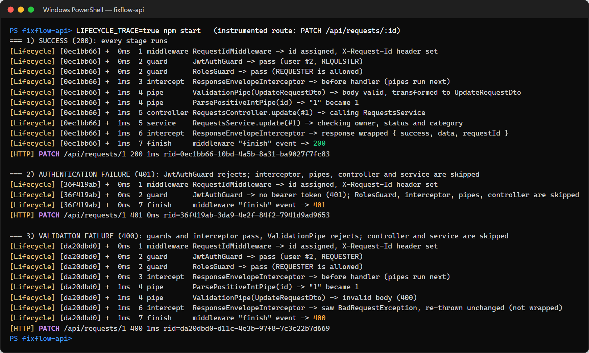

# Assignment 2 — FixFlow (NestJS API)

**Full Stack Web Development (CS-301) · Fall 2026 · CLO-3 GA-4**
**Abdul Raheem · 241854 · BSCS-V-A (Shift-I) · Air University Islamabad**

FixFlow is a campus maintenance and service dispatch system built with **NestJS 11 and TypeScript**.
- Requesters report faults, dispatchers assign eligible technicians, technicians record their progress, and requesters confirm completion and leave feedback.
- The API enforces the roles, record ownership, capacity limits and status transitions, and keeps an audit history of every status change.

| | |
|---|---|
| 🌐 **Project page (GitHub Pages)** | https://raheemxghumman.github.io/FULL-STACK-LAB/Assignment%202/ |
| 📦 **The API project (submitted as `241854.zip`)** | [`fixflow-api/`](fixflow-api/), with the full [README](fixflow-api/README.md) |
| 📄 **Architecture and lifecycle (2 pages)** | [`fixflow-api/docs/architecture-and-lifecycle.pdf`](fixflow-api/docs/architecture-and-lifecycle.pdf) |
| 🧪 **Postman collection + environment** | [`fixflow-api/postman/`](fixflow-api/postman/) |
| 🖼️ **Evidence (labelled screenshots + raw output)** | [`fixflow-api/docs/evidence/`](fixflow-api/docs/evidence/) |

## Results

| Check | Result |
|---|---|
| `npm test`: Jest + supertest end-to-end suite | **76 / 76 passing** (9 files, acceptance scenarios S1–S11) |
| `npm run test:postman`: Newman | **138 requests, 218 assertions, 0 failed** |
| `npm run demo:concurrency` | Limits hold under simultaneous requests; refused operations add no history |
| `npm run demo:fake-store` | `FIXFLOW_STORE` rebound to a fake store with no service edited |

## Quick start

```bash
cd fixflow-api
npm install
cp .env.example .env      # then set JWT_SECRET
npm run seed
npm start                 # http://localhost:3000/api   (Swagger: /api/docs)
npm test
```

## About the project page

The assignment is an API, and the brief says a frontend is not required and earns no marks. GitHub Pages also cannot run a NestJS server. The [project page](https://raheemxghumman.github.io/FULL-STACK-LAB/Assignment%202/) therefore presents the API rather than a user interface:
- an interactive state machine of the workflow;
- the recorded request-lifecycle trace;
- the module and injection-token architecture;
- the concurrency result;
- an endpoint explorer generated from the OpenAPI document;
- a replay of the real Postman run, with every request, response and assertion.

[](https://raheemxghumman.github.io/FULL-STACK-LAB/Assignment%202/)

### Files of the project page

```
Assignment 2/
├── index.html                 project page (GitHub Pages)
├── assets/css, assets/js      page styles and interactions (no frameworks)
├── assets/data/openapi.json   generated by `npm run openapi` in fixflow-api
├── assets/data/run.json       exported from the Newman report of the Postman run
└── fixflow-api/               the NestJS project (this is what 241854.zip contains)
```
