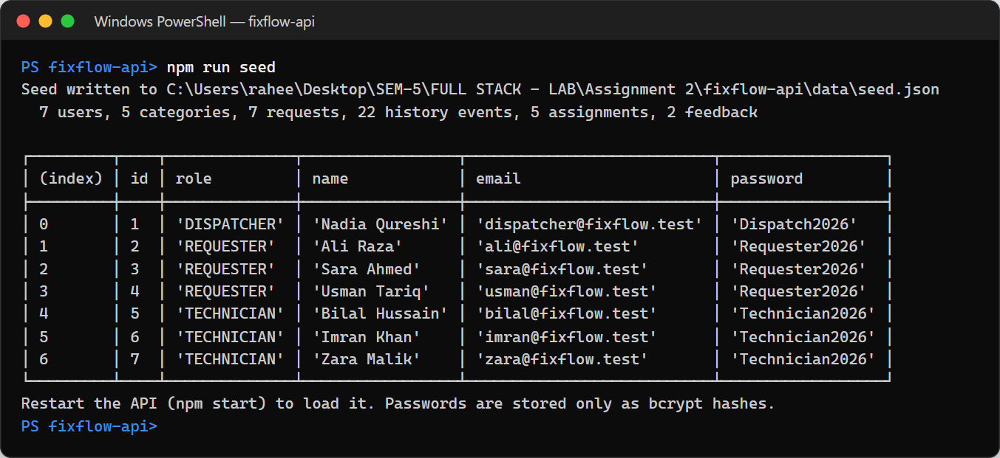
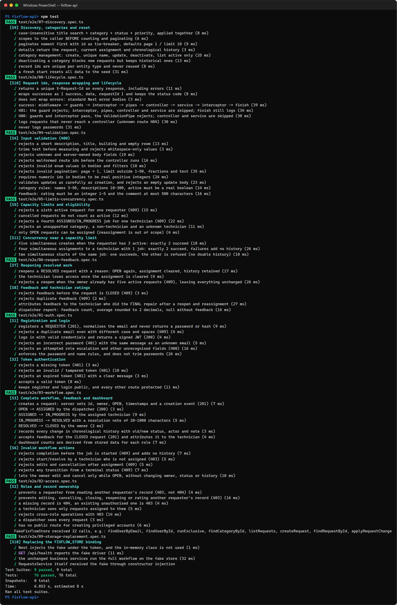
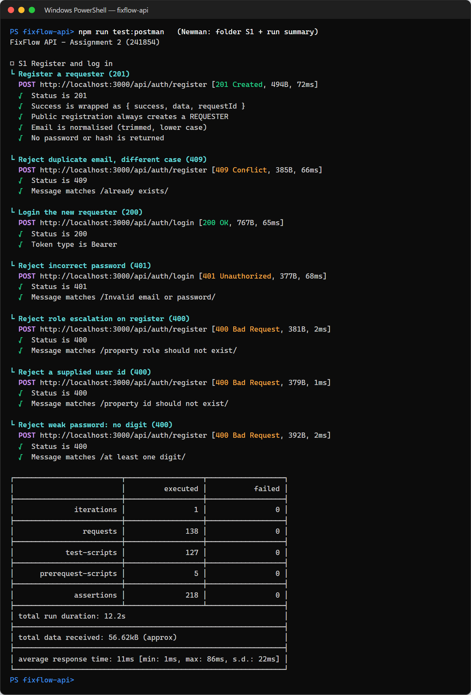
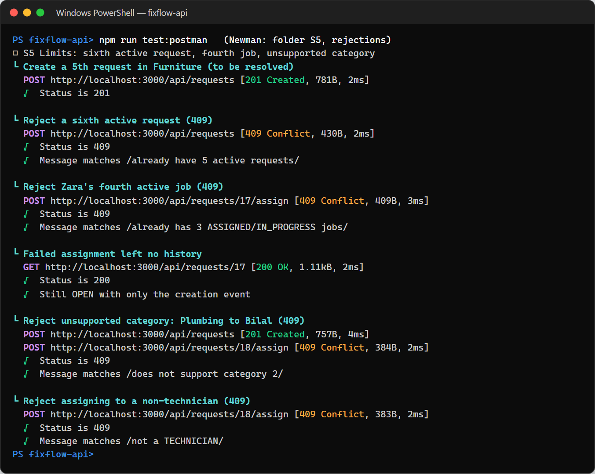
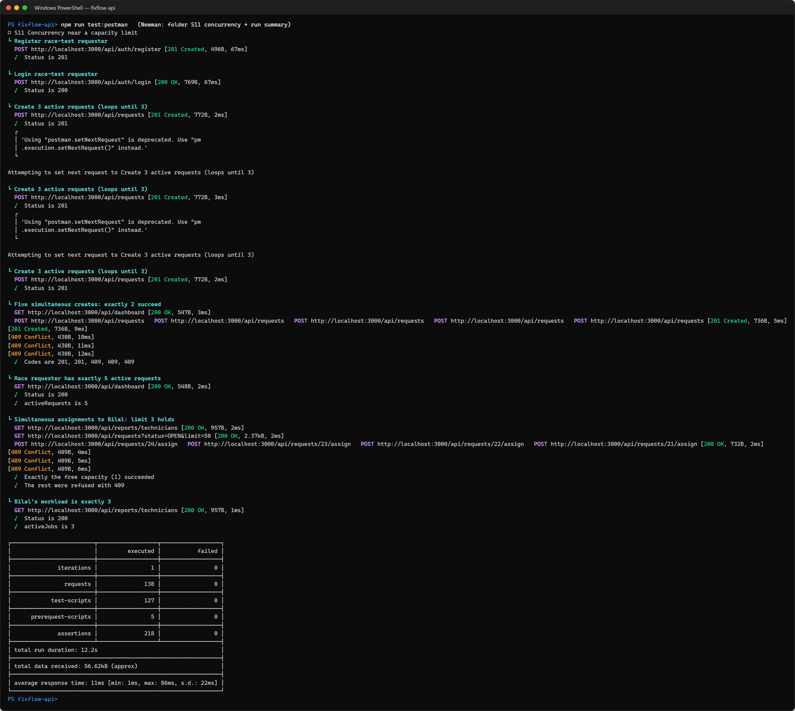
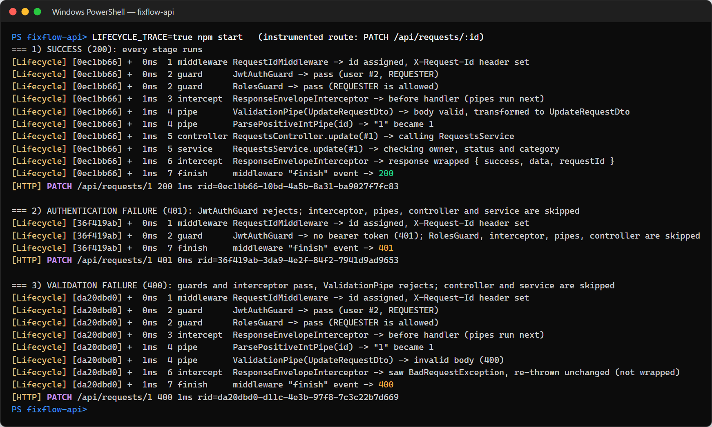
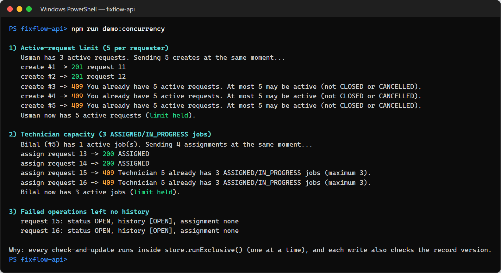
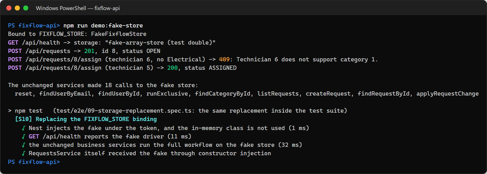
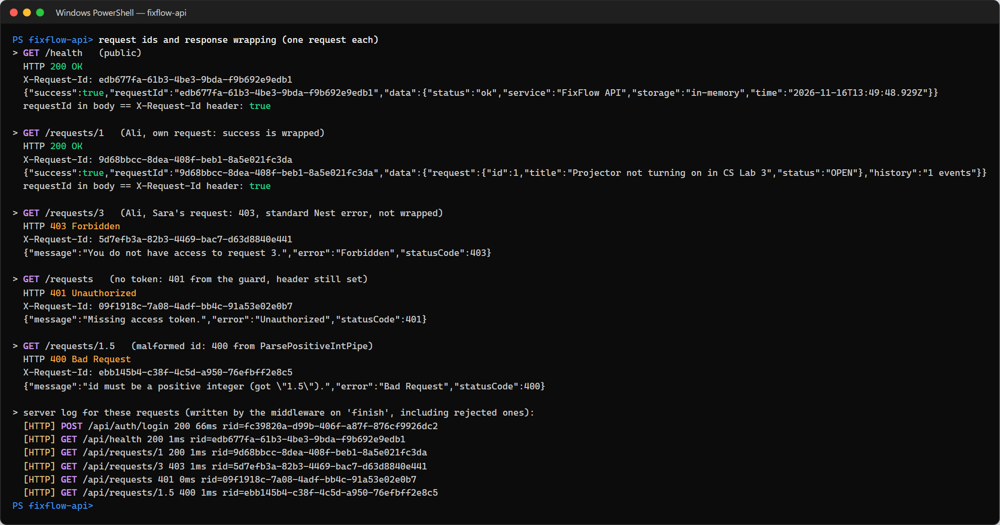

# FixFlow: Campus Maintenance and Service Dispatch API

**Assignment 2 · Full Stack Web Development (CS-301) · Fall 2026 · CLO-3 GA-4**

| | |
|---|---|
| **Student** | Abdul Raheem |
| **Roll number** | 241854 |
| **Class** | BSCS-V-A (Shift-I), Air University Islamabad |
| **Stack** | NestJS 11 · TypeScript 5 · class-validator · JWT · bcrypt · in-memory storage behind an injection token |

FixFlow replaces phone calls and informal messages with a secure maintenance workflow, in four steps:
1. A campus member (**REQUESTER**) submits a service request.
2. A **DISPATCHER** assigns an eligible **TECHNICIAN**.
3. The technician records the work.
4. The requester confirms completion (or reopens the request) and leaves feedback.

The API enforces the role permissions, record ownership, capacity limits and the status transitions, and records an audit history of every status change.

> 🌐 **Project page:** https://raheemxghumman.github.io/FULL-STACK-LAB/Assignment%202/ (architecture, workflow, every endpoint, and the recorded test results).

---

## Contents

1. [Tested versions](#1-tested-versions)
2. [Install, configure, seed, start, test](#2-install-configure-seed-start-test)
3. [Demonstration accounts and seed data](#3-demonstration-accounts-and-seed-data)
4. [Architecture](#4-architecture)
5. [Request workflow](#5-request-workflow)
6. [Endpoints and sample payloads](#6-endpoints-and-sample-payloads)
7. [Validation and HTTP behaviour](#7-validation-and-http-behaviour)
8. [Cross-cutting behaviour: request ids, wrapping, lifecycle](#8-cross-cutting-behaviour-request-ids-wrapping-lifecycle)
9. [Concurrency strategy](#9-concurrency-strategy)
10. [Tests, Postman collection and evidence](#10-tests-postman-collection-and-evidence)
11. [Requirement-to-code map](#11-requirement-to-code-map)
12. [Storage reset behaviour](#12-storage-reset-behaviour)
13. [Design decisions and known limitations](#13-design-decisions-and-known-limitations)
14. [Acknowledgements](#14-acknowledgements)

---

## 1. Tested versions

| Tool | Version |
|---|---|
| Node.js | **26.10.0** (Node 20 or newer is supported) |
| npm | 11.19.1 |
| NestJS (`@nestjs/core`, `common`, `platform-express`, `testing`) | **11.2.10** |
| `@nestjs/cli` · `@nestjs/config` · `@nestjs/jwt` · `@nestjs/swagger` | 11.0.24 · 4.0.4 · 11.0.2 · 11.4.8 |
| TypeScript | 5.9.3 |
| class-validator · class-transformer | 0.15.1 · 0.5.1 |
| bcryptjs (password hashing) | 3.0.3 |
| Jest · supertest · Newman | 29.7.0 · 7.3.2 · 6.2.3 |

## 2. Install, configure, seed, start, test

```bash
npm install                      # uses package-lock.json
cp .env.example .env             # Windows: copy .env.example .env  -> then set JWT_SECRET
npm run seed                     # writes data/seed.json (demo users, categories, requests)
npm start                        # http://localhost:3000/api   ·   Swagger UI: http://localhost:3000/api/docs
```

| Command | What it does |
|---|---|
| `npm run seed` | Writes the reproducible seed snapshot to `SEED_FILE` (default `data/seed.json`) and prints the demo accounts. |
| `npm start` / `npm run start:dev` | Builds and starts the API (`start:dev` restarts on changes). |
| `npm test` | Runs the **76 end-to-end tests** (Jest + supertest) on the real application with fresh seed data. No server is needed. |
| `npm run test:postman` | Runs the **Postman collection** with Newman against a running, freshly started API. The expired token is created for you. |
| `npm run token:expired` | Prints a correctly signed token that has already expired, for manual Postman runs. |
| `npm run demo:concurrency` | Sends competing requests to the running API near the capacity limits. |
| `npm run demo:fake-store` | Starts the app with `FIXFLOW_STORE` bound to a fake store and runs a short workflow. |
| `LIFECYCLE_TRACE=true npm start` | Logs every lifecycle stage of the instrumented route `PATCH /api/requests/:id`. On Windows PowerShell: `$env:LIFECYCLE_TRACE="true"; npm start` |

**Configuration (`.env`; see [.env.example](.env.example)):**

| Variable | Meaning | Default |
|---|---|---|
| `PORT` | HTTP port | `3000` |
| `JWT_SECRET` | Signing secret for access tokens (**required**, at least 16 characters; the app refuses to start without it) | – |
| `JWT_EXPIRES_IN` | Token lifetime (`900`, `15m`, `1h`, `1d`) | `1h` |
| `BCRYPT_ROUNDS` | bcrypt cost factor | `10` |
| `SEED_FILE` | Seed snapshot loaded at start-up | `data/seed.json` |
| `LIFECYCLE_TRACE` | Print the lifecycle trace for the instrumented route | `false` |

Secrets are read only from the environment through `@nestjs/config`, and the variables are validated at start-up. `.env` is git-ignored and is not in the submission ZIP.

## 3. Demonstration accounts and seed data

These are documented demo values, not real credentials. Passwords are stored only as bcrypt hashes.

| Id | Role | Name | Email | Password | Supported categories |
|---|---|---|---|---|---|
| 1 | DISPATCHER | Nadia Qureshi | `dispatcher@fixflow.test` | `Dispatch2026` | – |
| 2 | REQUESTER | Ali Raza | `ali@fixflow.test` | `Requester2026` | – |
| 3 | REQUESTER | Sara Ahmed | `sara@fixflow.test` | `Requester2026` | – |
| 4 | REQUESTER | Usman Tariq | `usman@fixflow.test` | `Requester2026` | – |
| 5 | TECHNICIAN | Bilal Hussain | `bilal@fixflow.test` | `Technician2026` | Electrical (1), IT Support (3) |
| 6 | TECHNICIAN | Imran Khan | `imran@fixflow.test` | `Technician2026` | Plumbing (2), Furniture (4) |
| 7 | TECHNICIAN | Zara Malik | `zara@fixflow.test` | `Technician2026` | Electrical, IT Support, Furniture, HVAC |

Technician and dispatcher accounts exist **only** through the seed command. There is no public route that creates a privileged account.

**Categories:** 1 Electrical, 2 Plumbing, 3 IT Support, 4 Furniture, and 5 HVAC, which is **deactivated** but still has a historical request.

**Seven representative requests, one in every status**, each with a full history:

| # | Owner | Category | Status |
|---|---|---|---|
| 1 | Ali | IT Support | OPEN |
| 2 | Ali | Plumbing | ASSIGNED to Imran |
| 3 | Sara | Electrical | IN_PROGRESS (Bilal) |
| 4 | Sara | IT Support | RESOLVED by Zara |
| 5 | Ali | Furniture | CLOSED (Imran) + feedback 4★ |
| 6 | Sara | HVAC, inactive category | CLOSED (Zara) + feedback 5★ |
| 7 | Sara | Furniture | CANCELLED |

## 4. Architecture

```
AppModule ── ConfigModule (global, validated .env)
   ├── StorageModule    provides FIXFLOW_STORE → InMemoryFixflowStore, SeedService     exports FIXFLOW_STORE
   ├── UsersModule      UsersService, UsersController                                  exports UsersService
   ├── AuthModule       AuthService, AuthController, JwtAuthGuard, RolesGuard, JwtModule
   ├── CategoriesModule CategoriesService, CategoriesController                        exports CategoriesService
   ├── RequestsModule   RequestsService (workflow rules), RequestAccessPolicy (ownership), RequestsController
   └── ReportsModule    ReportsService, ReportsController (/dashboard, /reports/technicians)

Global pipeline (registered with APP_* providers in AppModule):
RequestIdMiddleware → JwtAuthGuard → RolesGuard → ResponseEnvelopeInterceptor → ValidationPipe / param pipes
→ Controller → Service → FIXFLOW_STORE → Interceptor (wrap) → Middleware "finish" log
```

- **Controllers handle HTTP only.** They define routes, `@Roles`, pipes and `@HttpCode`. Every business rule lives in a service.
- **Constructor injection everywhere.** Nothing is created with `new`. Shared providers are exported and imported through modules.
- **Custom injection token.** [`src/storage/fixflow-store.interface.ts`](src/storage/fixflow-store.interface.ts) defines `FIXFLOW_STORE` (a `Symbol`) and the typed `FixflowStore` contract. `StorageModule` binds `{ provide: FIXFLOW_STORE, useClass: InMemoryFixflowStore }` and exports the token. Services inject it with `@Inject(FIXFLOW_STORE)`.
- **Second implementation.** [`test/fakes/fake-fixflow.store.ts`](test/fakes/fake-fixflow.store.ts) is a small array-based store that records every call. `.overrideProvider(FIXFLOW_STORE).useClass(FakeFixflowStore)` binds it in [`test/e2e/09-storage-replacement.spec.ts`](test/e2e/09-storage-replacement.spec.ts) and in `npm run demo:fake-store`, without editing any service.
- **No request data in singletons.** User identity and filters are passed as parameters. The request id and trace flag live in `AsyncLocalStorage` ([`src/common/request-context.ts`](src/common/request-context.ts)).

The two-page explanation is in [docs/architecture-and-lifecycle.pdf](docs/architecture-and-lifecycle.pdf) ([Markdown version](docs/architecture-and-lifecycle.md)).

## 5. Request workflow

```
              assign (dispatcher)        start (assigned tech)       resolve + note (assigned tech)
   OPEN ─────────────────────▶ ASSIGNED ─────────────────▶ IN_PROGRESS ─────────────────────▶ RESOLVED
    │ ▲                                                                                       │   │
    │ └──────────────────────── reopen + reason (owner; clears the assignment) ────────────────┘   │
    │ cancel (owner)                                                              close (owner)    │
    ▼                                                                                              ▼
 CANCELLED (final)                                                                         CLOSED (final) → feedback (owner, once)
```

All transitions not shown are refused with **409**; the table is in [`src/requests/request-transitions.ts`](src/requests/request-transitions.ts).

**Limits:**
- At most **5 active requests** per requester ("active" means any status except CLOSED and CANCELLED). The limit applies to creating and to reopening.
- A technician can hold at most **3 ASSIGNED or IN_PROGRESS jobs**.

**Assignment:**
- The technician must exist, have the TECHNICIAN role and support the request's category.
- Reassigning an already assigned request is out of scope; only OPEN requests can be assigned.

**History:** every successful status change records the old status, new status, actor id, time and note. A creation event is recorded first. Edits are not status changes, so they add no history and never change the owner, status or assignment.

**Feedback** is allowed only on CLOSED requests, by the owner, once. It is attributed to `resolvedByTechnicianId`, the technician who completed the **final** successful repair. Dispatcher reports show each technician's feedback count and average rating, rounded to 2 decimals, or `null` when there is no feedback.

## 6. Endpoints and sample payloads

All routes use the `/api` prefix. Every route except register, login and health needs `Authorization: Bearer <accessToken>`. Successful responses are wrapped as `{ "success": true, "data": …, "requestId": "…" }`. **Scoped** means requesters see only their own records, technicians only the requests assigned to them, and dispatchers everything.

| Method | Route | Who | Success | Purpose |
|---|---|---|---|---|
| POST | `/api/auth/register` | public | 201 | Register a **REQUESTER** (`fullName`, `email`, `password`) |
| POST | `/api/auth/login` | public | 200 | Log in; returns `accessToken` |
| GET | `/api/health` | public | 200 | Status and the storage driver in use |
| GET | `/api/users/me` | any | 200 | Own profile |
| GET | `/api/users/technicians` | dispatcher | 200 | Technicians and their supported categories |
| GET | `/api/categories` | any | 200 | Active categories (`?includeInactive=true` for dispatchers) |
| POST | `/api/categories` | dispatcher | 201 | Create a category |
| PATCH | `/api/categories/:id` | dispatcher | 200 | Update or deactivate (`{ "active": false }`) |
| POST | `/api/requests` | requester | 201 | Create a request |
| GET | `/api/requests` | scoped | 200 | Search, filter and paginate (`q`, `categoryId`, `status`, `priority`, `page`, `limit`) |
| GET | `/api/requests/:id` | scoped | 200 | Request, current assignment, assignment history, chronological status history, feedback |
| PATCH | `/api/requests/:id` | owner | 200 | Edit own **OPEN** request |
| POST | `/api/requests/:id/cancel` | owner | 200 | OPEN → CANCELLED |
| POST | `/api/requests/:id/assign` | dispatcher | 200 | OPEN → ASSIGNED (`technicianId`) |
| POST | `/api/requests/:id/start` | assigned technician | 200 | ASSIGNED → IN_PROGRESS |
| POST | `/api/requests/:id/resolve` | assigned technician | 200 | IN_PROGRESS → RESOLVED (`resolutionNote`) |
| POST | `/api/requests/:id/close` | owner | 200 | RESOLVED → CLOSED |
| POST | `/api/requests/:id/reopen` | owner | 200 | RESOLVED → OPEN (`reason`; clears the assignment) |
| POST | `/api/requests/:id/feedback` | owner | 201 | Rating 1-5 and optional comment, for CLOSED requests only |
| GET | `/api/dashboard` | any | 200 | Role-specific summary |
| GET | `/api/reports/technicians` | dispatcher | 200 | Workload, resolved jobs, feedback count and average rating per technician |

Swagger UI with every schema is at `http://localhost:3000/api/docs`, and a copy is on the project page.

### Sample payloads

```jsonc
// POST /api/auth/register                                      -> 201
{ "fullName": "Hamza Ali", "email": "Hamza@FixFlow.test", "password": "Campus2026" }
// data: { "id": 8, "fullName": "Hamza Ali", "email": "hamza@fixflow.test", "role": "REQUESTER", "createdAt": "…" }

// POST /api/auth/login                                          -> 200
{ "email": "ali@fixflow.test", "password": "Requester2026" }
// data: { "accessToken": "eyJ…", "tokenType": "Bearer", "expiresIn": "1h", "user": { "id": 2, "role": "REQUESTER", … } }

// POST /api/requests  (requester)                               -> 201
{ "title": "Projector flickering in Room A-12",
  "description": "The projector flickers every few seconds and then switches itself off.",
  "categoryId": 3, "building": "Academic Block A", "room": "A-12", "priority": "HIGH" }
// data: { "id": 8, …, "status": "OPEN", "requesterId": 2, "assignedTechnicianId": null, "createdAt": "…", "updatedAt": "…" }

// PATCH /api/requests/8  (owner, only while OPEN)               -> 200
{ "room": "A-14", "priority": "MEDIUM" }

// POST /api/requests/8/assign   (dispatcher)                    -> 200
{ "technicianId": 5 }

// POST /api/requests/8/resolve  (assigned technician)           -> 200
{ "resolutionNote": "Replaced the faulty HDMI cable and tested the projector twice." }

// POST /api/requests/8/reopen   (owner)                         -> 200
{ "reason": "The projector is flickering again today." }

// POST /api/requests/8/feedback (owner, CLOSED only)            -> 201
{ "rating": 5, "comment": "Fixed quickly and politely." }

// POST /api/categories (dispatcher) -> 201      PATCH /api/categories/6 -> 200
{ "name": "Painting", "description": "Walls, doors and railings." }      { "active": false }

// GET /api/requests?q=projector&categoryId=3&status=OPEN&priority=HIGH&page=1&limit=10   -> 200
// data: { "items": [ … ], "page": 1, "limit": 10, "total": 4, "totalPages": 1 }
```

**Error example:** standard Nest exception responses, never wrapped and without stack traces:

```json
{ "statusCode": 409, "message": "Technician 5 already has 3 ASSIGNED/IN_PROGRESS jobs (maximum 3).", "error": "Conflict" }
```

## 7. Validation and HTTP behaviour

**Global `ValidationPipe`:** `transform: true`, `whitelist: true`, `forbidNonWhitelisted: true` and **no implicit conversion**.
- **Bodies and queries** use class-based DTOs ([`src/requests/dto/request.dto.ts`](src/requests/dto/request.dto.ts), [`src/auth/auth.dto.ts`](src/auth/auth.dto.ts), [`src/categories/categories.dto.ts`](src/categories/categories.dto.ts)).
- **Numeric query values** are converted explicitly (`toInteger`: digits only), then range-checked. `1.5`, `abc`, `1e2` and `0x10` are rejected.
- **Route ids** go through `ParsePositiveIntPipe`, a custom equivalent of `ParseIntPipe` at parameter scope. It accepts only `1…` written as digits. The global pipe deliberately leaves route params alone; otherwise its primitive conversion would already turn `"1.5"` into `1.5` before the param pipe runs.
- **Text** is trimmed before its length is measured, and whitespace-only values are rejected. **Passwords are never trimmed or changed.**

| Field | Rule |
|---|---|
| fullName | 3-80 characters |
| email | valid; trimmed and lower-cased; unique |
| password | 8-72 characters, at least one letter and one digit |
| category name | 3-50 characters, unique (case-insensitive) |
| category description | 10-300 characters |
| active | a real JSON boolean |
| title | 5-100 characters |
| description | 20-1000 characters |
| building | 2-80 characters |
| room | 1-30 characters |
| priority | LOW / MEDIUM / HIGH |
| status filter | one of the six statuses |
| categoryId / technicianId | positive JSON integers that refer to existing, eligible records |
| page | at least 1 (default 1) |
| limit | 1-50 (default 10) |
| resolutionNote | 20-1000 characters |
| reopen reason | 10-500 characters |
| feedback rating | integer 1-5 |
| feedback comment | 1-500 characters when given |
| update bodies | must not be empty; may not contain `status`, `requesterId`, `assignedTechnicianId`, timestamps, `history` or unknown fields (400) |
| register | `role`, `id`, `userId` and any other unknown field are rejected (400) |

| Code | Used for |
|---|---|
| 201 | new resources: register, create request, create category, feedback |
| 200 | reads and successful actions (login, assign, start, resolve, close, reopen, cancel, edit) |
| 400 | invalid input (DTOs, pipes, empty update, malformed id) |
| 401 | missing, malformed, wrongly signed or **expired** token; wrong login |
| 403 | wrong role (`RolesGuard`), or an existing record the caller may not access (`RequestAccessPolicy`) |
| 404 | unknown request, category or technician id; unknown route |
| 409 | duplicate email or category name; 5 active requests; technician at capacity; unsupported category; non-technician; deactivated category; invalid transition; duplicate or early feedback; stale write |

For an existing record the caller may not access, the API always answers **403**, and authorization is checked **before** any state detail is revealed. Every action follows the same order: load (404), then authorize (403), then transition (409), then limits (409), then one atomic write.

## 8. Cross-cutting behaviour: request ids, wrapping, lifecycle

- **Middleware** ([`request-id.middleware.ts`](src/common/request-id.middleware.ts)) generates a UUID for every request, attaches it to the request and returns it in `X-Request-Id`. When the response **finishes** it logs `METHOD path status duration rid=…`. This also covers 401s, 404s and pipe errors that never reach the interceptor. Only the path is logged: no query string, body, password, token or authorization header.
- **Interceptor** ([`response-envelope.interceptor.ts`](src/common/response-envelope.interceptor.ts)) wraps successes as `{ success: true, data, requestId }`. It keeps the status code and never wraps twice. Errors pass through unchanged as standard Nest responses (`catchError` re-throws the original exception).
- **Lifecycle evidence:** run `LIFECYCLE_TRACE=true npm start`. The instrumented route `PATCH /api/requests/:id` then logs each stage: middleware → JwtAuthGuard → RolesGuard → interceptor (before) → pipes → controller → service → interceptor (after or error) → middleware finish.
  - **401:** the guard rejects; the interceptor, pipes, controller and service are skipped.
  - **400:** guards and interceptor pass, the `ValidationPipe` rejects, the interceptor sees the error and re-throws it, and the controller and service are skipped.
  - The trace is shown in [docs/evidence/04-lifecycle-trace.png](docs/evidence/04-lifecycle-trace.png) and asserted in [test/e2e/08-lifecycle.spec.ts](test/e2e/08-lifecycle.spec.ts).

## 9. Concurrency strategy

1. **One action at a time.** Every check-and-update in a service runs inside `store.runExclusive()`, a promise-chain mutex. No other action can change the data between the checks and the write, even across `await`.
2. **All-or-nothing writes.** `applyRequestChange()` updates the request, its history event and its assignment together, synchronously. A rule that fails throws first, so **failed actions leave no trace**.
3. **Version check.** Each request carries a `version`. A stale `expectedVersion` is refused with 409 instead of overwriting a newer status.
4. **Unique keys checked inside the store write.** Duplicate emails, duplicate category names and duplicate feedback are refused there, so two registrations racing for one email cannot both succeed.

**Results:**
- 5 simultaneous creates for a requester with 3 active requests: exactly 2 × 201 and 3 × 409.
- 4 simultaneous assignments to a technician with 1 job: exactly 2 × 200 and 2 × 409, with no history on the refused ones.
- 2 simultaneous starts of the same job: 200 + 409.

See `npm test` (S11), the Postman folder S11 and `npm run demo:concurrency`.

## 10. Tests, Postman collection and evidence

- **Jest end-to-end suite** ([`test/e2e`](test/e2e)): 9 files and **76 tests**, run against the real `AppModule` with fresh seed data. Each `describe` block is labelled with the acceptance scenario it proves (`[S1]` … `[S11]`).
- **Postman** ([`postman/`](postman)): `FixFlow.postman_collection.json` (117 requests in 12 folders, about 220 assertions; loops make 138 calls) and `FixFlow.postman_environment.json` (template).
  - `baseUrl` and every token are variables. Login requests store the tokens automatically.
  - The checks cover status codes, messages and response bodies, for both successful workflows and rejected requests.
  - Run it in Postman (import both files, set `expiredToken` from `npm run token:expired`, then Run collection), or with `npm run test:postman`.
  - **Start the API fresh first**, because some checks expect the seed state.

| Acceptance scenario | Jest | Postman folder | Evidence |
|---|---|---|---|
| Register, login; duplicate email, wrong password, role escalation | `01-auth` [S1] | S1 | [03a](docs/evidence/03a-postman-auth.png) |
| Missing/invalid/expired tokens, cross-role, another requester's record | `01-auth`, `02-access` [S2] | S2 | [02](docs/evidence/02-jest-e2e-tests.png) |
| OPEN→ASSIGNED→IN_PROGRESS→RESOLVED→CLOSED, feedback, dashboards | `03-workflow` [S3] | S3 | [02](docs/evidence/02-jest-e2e-tests.png) |
| Short description, unknown fields, malformed ids, enums, pagination | `04-validation` [S4] | S4 | [02](docs/evidence/02-jest-e2e-tests.png) |
| Sixth active request, fourth job, unsupported category | `05-limits` [S5] | S5 | [03b](docs/evidence/03b-postman-limits.png) |
| Completion before start, unassigned technician, edit/cancel after assignment | `03-workflow` [S6] | S6 | [02](docs/evidence/02-jest-e2e-tests.png) |
| Reopen with reason, assignment cleared, history kept, limit on reopen | `06-reopen-feedback` [S7] | S7 | [02](docs/evidence/02-jest-e2e-tests.png) |
| Early/duplicate feedback, attribution after reassignment, averages | `06-reopen-feedback` [S8] | S8 | [02](docs/evidence/02-jest-e2e-tests.png) |
| Search + filters + pagination, scoping, totals, deactivation, seed reset | `07-discovery` [S9] | S9 | [02](docs/evidence/02-jest-e2e-tests.png) |
| Request ids, wrapping, lifecycle logs (200/401/400), storage replacement | `08-lifecycle`, `09-storage` [S10] | S10 | [04](docs/evidence/04-lifecycle-trace.png) · [06](docs/evidence/06-storage-replacement.png) · [07](docs/evidence/07-request-id-and-wrapping.png) |
| Competing requests near a capacity limit | `05-limits` [S11] | S11 | [03c](docs/evidence/03c-postman-concurrency.png) · [05](docs/evidence/05-concurrency-demo.png) |

All evidence is in [docs/evidence](docs/evidence). Each image has a matching `.txt` file with the raw output:

| Seed command | All 76 tests passing |
|---|---|
|  |  |

| Postman: S1 auth + run summary (0 failures) | Postman: S5 limits |
|---|---|
|  |  |

| Postman: S11 concurrency | Lifecycle trace: 200 / 401 / 400 |
|---|---|
|  |  |

| Concurrency demo on the running API | Storage provider replacement |
|---|---|
|  |  |



## 11. Requirement-to-code map

| Requirement (marks) | Where |
|---|---|
| Registration & login (5) | [`auth/auth.service.ts`](src/auth/auth.service.ts), [`auth/auth.dto.ts`](src/auth/auth.dto.ts), [`users/users.service.ts`](src/users/users.service.ts) (role fixed to REQUESTER), store email uniqueness |
| Authentication (4) | [`auth/jwt-auth.guard.ts`](src/auth/jwt-auth.guard.ts) (global), `JwtModule.registerAsync` in [`auth/auth.module.ts`](src/auth/auth.module.ts), [`config/env.validation.ts`](src/config/env.validation.ts) |
| Authorization (6) | `@Roles` in [`common/decorators.ts`](src/common/decorators.ts), [`auth/roles.guard.ts`](src/auth/roles.guard.ts), [`requests/request-access.policy.ts`](src/requests/request-access.policy.ts) |
| Category management (5) | [`categories/`](src/categories) |
| Search & filters (6) · Pagination & details (4) | `RequestsService.list` / `details`, `ListRequestsQueryDto` |
| Create & manage requests (7) · Assignment (6) · Progress & completion (7) | [`requests/requests.service.ts`](src/requests/requests.service.ts), [`requests/request-transitions.ts`](src/requests/request-transitions.ts) |
| Consistency & audit history (5) | `applyRequestChange` in [`storage/in-memory-fixflow.store.ts`](src/storage/in-memory-fixflow.store.ts), `runExclusive` + [`storage/mutex.ts`](src/storage/mutex.ts) |
| Role-specific summaries (6) · Technician ratings (4) | [`reports/reports.service.ts`](src/reports/reports.service.ts) |
| Feedback (5) | `RequestsService.submitFeedback` |
| Modules & DI (7) | [`app.module.ts`](src/app.module.ts) and the six feature modules |
| Custom injection token (5) | [`storage/fixflow-store.interface.ts`](src/storage/fixflow-store.interface.ts), [`storage/storage.module.ts`](src/storage/storage.module.ts), [`test/fakes/fake-fixflow.store.ts`](test/fakes/fake-fixflow.store.ts) |
| DTOs & transformation (5) · Parameter pipes (3) | [`common/pipes.ts`](src/common/pipes.ts), [`common/transformers.ts`](src/common/transformers.ts), DTO files |
| Middleware (3) · Interceptor (4) · Lifecycle evidence (3) | [`common/request-id.middleware.ts`](src/common/request-id.middleware.ts), [`common/response-envelope.interceptor.ts`](src/common/response-envelope.interceptor.ts), [`common/request-context.ts`](src/common/request-context.ts) |

## 12. Storage reset behaviour

- Data is kept **in memory only**, by `InMemoryFixflowStore`.
- On every start, `SeedService` loads `SEED_FILE` (`data/seed.json`) into the store. If that file is missing, the same snapshot is built in memory and a warning is logged.
- **Stopping and starting the API resets all data to the seed.** Changes made through the API are never written back to the seed file.
- Run `npm run seed` to regenerate the snapshot (for example after changing [`src/seed/seed-data.ts`](src/seed/seed-data.ts) or `BCRYPT_ROUNDS`).
- Every test file starts its own application, so tests always begin from the seed.
- Record ids are never reused, even after a cancellation.

## 13. Design decisions and known limitations

- **404 vs 409 for references.** A referenced id that does not exist gives **404**. One that exists but is not eligible gives **409**: a deactivated category, a user who is not a technician, an unsupported category, or a technician at capacity.
- **Reopen limit.** A RESOLVED request is already active. Reopening is therefore refused when the owner has 5 active requests **including the one being reopened**; with any other reading the required rejection could never happen.
- **Technician visibility.** Technicians see the requests **currently** assigned to them. A reopen clears the assignment, so the previous technician loses access until they are assigned again. The assignment history keeps the record.
- **Concurrency.** `runExclusive` serialises writes inside **one Node process**, as the assignment requires. Several instances would need a database transaction or a conditional update (see section 9).
- **Data.** Data is not persistent, and seed passwords are demo values. JWTs cannot be revoked before they expire; refresh tokens and logout are optional extensions and were not built.
- **Reassignment** of an ASSIGNED or IN_PROGRESS request is out of scope, as the brief says.
- **The Postman collection expects freshly seeded data.** Restart the API before running it. The Jest suite needs no running server.

## 14. Acknowledgements

- **Frameworks and libraries:** NestJS, class-validator, class-transformer, `@nestjs/jwt`, bcryptjs, Jest, supertest and Newman.
- **Documentation used:** the official NestJS documentation on custom providers, validation, guards, interceptors and the request lifecycle (docs.nestjs.com).
- **AI assistance:** the course policy asks students to acknowledge AI tools. I used an AI assistant (Claude by Anthropic) while building and documenting this project. I reviewed every feature and can explain and modify it in the demonstration.
