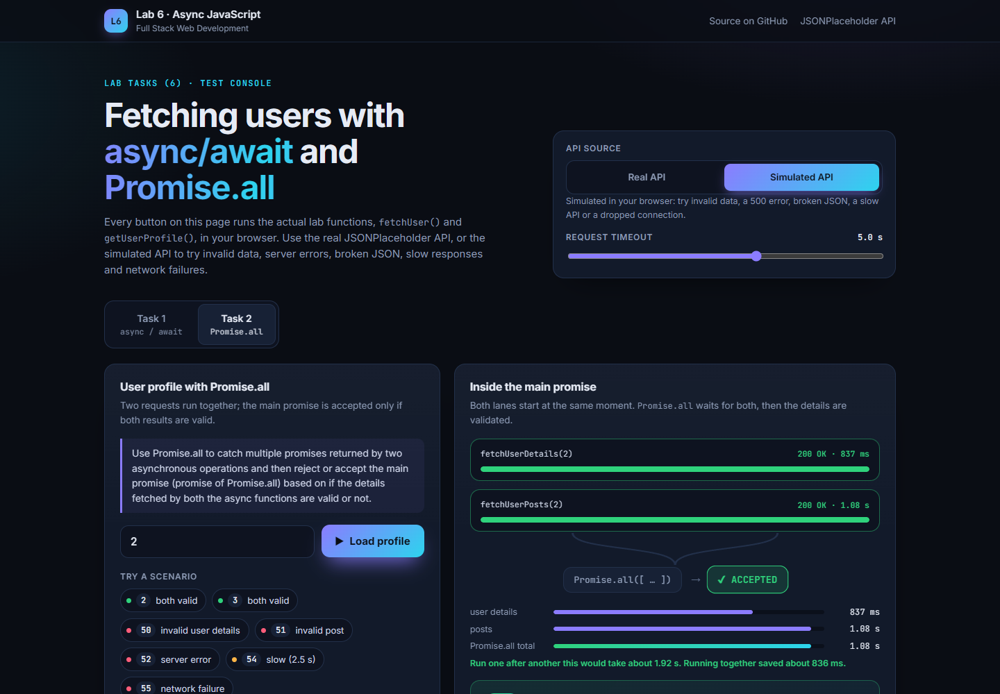
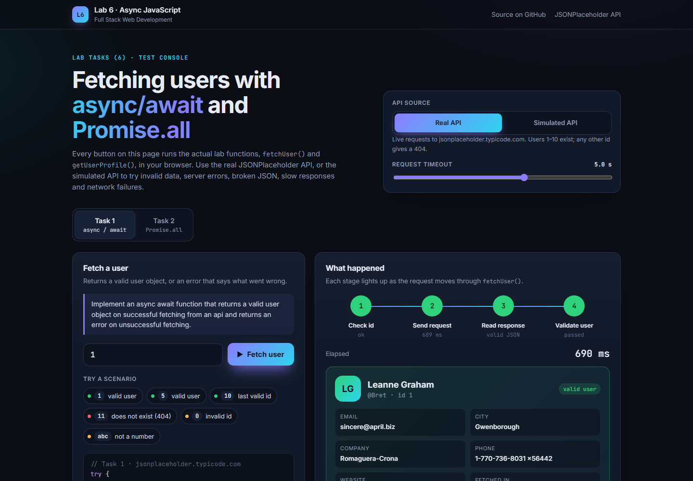
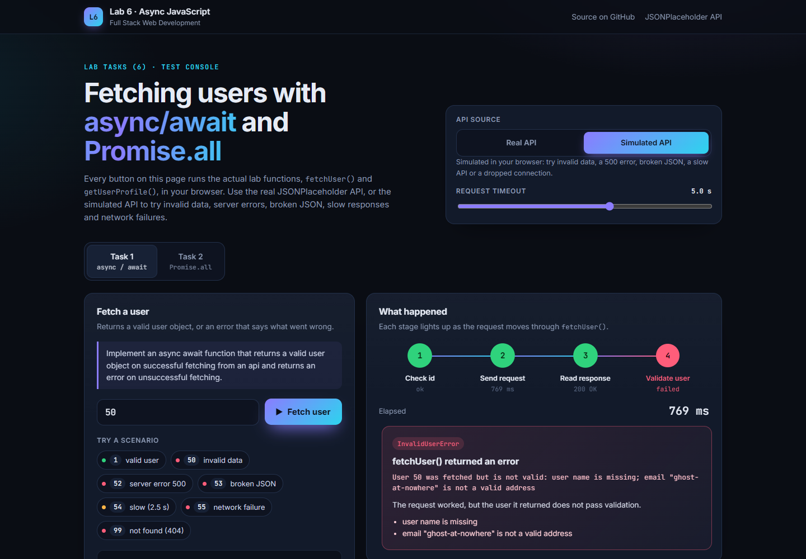
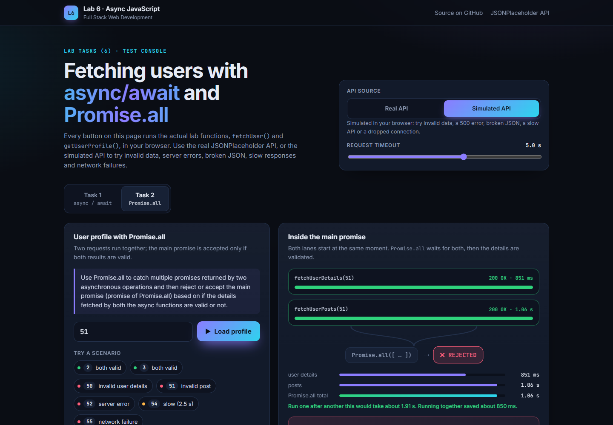
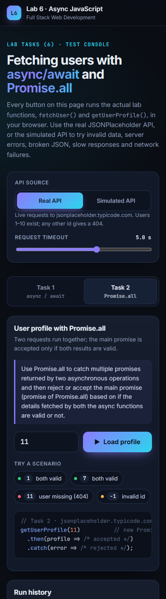

# Full Stack Web Development — Lab 6

## async/await and Promise.all

**Student:** Abdul Raheem · BSCS-V-A (Shift-I) · Air University, Islamabad

**Live test UI:** [raheemxghumman.github.io/FULL-STACK-LAB/Lab - 6](https://raheemxghumman.github.io/FULL-STACK-LAB/Lab%20-%206/)



## The tasks

1. *Implement an async await function that returns a valid user object on successful fetching from an api and returns an error on unsuccessful fetching.*
2. *Use Promise.all to catch multiple promises returned by two asynchronous operations and then reject or accept the main promise (promise of Promise.all) based on if the details fetched by both the async functions are valid or not.*

The API used is [JSONPlaceholder](https://jsonplaceholder.typicode.com/users), fetched with the built-in `fetch`. Everything is plain JavaScript with ES modules and no packages.

### Task 1: `fetchUser(userId)`, in [`Task-1-Async-Await/fetchUser.js`](Task-1-Async-Await/fetchUser.js)

An `async` function that `await`s the request and resolves with a clean, validated user object
(`id, name, username, email, phone, website, city, company`). On any failure it returns an error: the
returned promise rejects with an error class that says what went wrong.

| Situation | Error |
|---|---|
| id is not a positive whole number (checked before any request) | `TypeError` |
| the API answers with 404, 500 … | `HttpError` (with `status`) |
| the API cannot be reached | `NetworkError` |
| the API is slower than the timeout | `RequestTimeout` |
| the response is not JSON | `InvalidJSONError` |
| the user arrives but has no name, a bad email, the wrong id … | `InvalidUserError` (with `problems`) |

```js
try {
  const user = await fetchUser(1);
} catch (error) {
  console.log(error.name, error.message);
}
```

### Task 2: `getUserProfile(userId)`, in [`Task-2-Promise-All/userProfile.js`](Task-2-Promise-All/userProfile.js)

The two asynchronous operations are `fetchUserDetails(id)` (`/users/:id`) and `fetchUserPosts(id)`
(`/posts?userId=:id`). `getUserProfile` returns a main promise created with `new Promise(...)`. Inside it,
`Promise.all` starts both operations at the same time and waits for them. Then:

- **resolve (accept):** both requests succeeded, the user details pass `validateUser`, and every post passes `validatePosts`.
- **reject:** either request failed (`Promise.all` rejects as soon as one fails), or the details are invalid. The `InvalidDetailsError` lists the problems found in the user details and in the posts separately.

Because both requests run concurrently, the total time is about the slower request, not the sum of both.
The demo shows 156 ms instead of 313 ms.

## The test UI

`index.html` is an interactive, animated page that runs the actual `fetchUser()` and `getUserProfile()`
modules in the browser. It is hosted on GitHub Pages.

- **Real API** sends live requests to JSONPlaceholder. Users 1–10 exist; other ids give 404.
- **Simulated API** runs in the browser and adds the cases a real API cannot produce on demand: invalid user data, an invalid post, HTTP 500, broken JSON, a slow response (try lowering the timeout slider) and a dropped connection.
- **Task 1** shows an animated four-step pipeline: check id, send request, read response, validate user. It ends in a user card or an error card that explains the error type.
- **Task 2** shows two lanes that start together, merge into `Promise.all`, and end in an **ACCEPTED** or **REJECTED** verdict. It also shows timing bars with the time saved by running the requests concurrently.

| Task 1 success | Task 1 invalid user |
|---|---|
|  |  |

| Task 2 rejected (invalid post) | Mobile |
|---|---|
|  |  |

## Running locally (Node.js 18+, nothing to install)

```
npm run task1       # Task 1 demo: real API + local mock API
npm run task2       # Task 2 demo
npm test            # 17 automated tests (node:test) against the local mock API
npm run ui          # the test UI at http://localhost:5173 (browsers block ES modules from file://)
npm run mock-api    # the mock API on its own at http://localhost:4000
```

## Structure

```
Lab - 6/
├── Task-1-Async-Await/     fetchUser.js (Task 1) · demo.js
├── Task-2-Promise-All/     userProfile.js (Task 2) · demo.js
├── lib/                    http.js (fetchJSON + error classes) · validate.js (validation rules)
├── mock-api/               data.js (shared routes and data) · server.js (node:http mock API)
├── index.html · ui/        test UI: app.js · style.css · mockFetch.js (browser version of the mock API)
├── scripts/serve.js        local static server for the UI
└── tests/lab6.test.js
```
