# Lab 7 · Part 1 — Student Management System (in-memory API)

**Student:** Abdul Raheem · 241854 · BSCS-V-A (Shift-I) · Air University, Islamabad

> **Task:** Modify the uploaded code (file: *in memory api*) and create a student management system.
> Modules: **Student** (CRUD), **Teacher** (CRUD), **Attendance** (CRUD), **Marks** (CRUD).

**Live test UI:** [raheemxghumman.github.io/FULL-STACK-LAB/Lab 7/Part 1/public](https://raheemxghumman.github.io/FULL-STACK-LAB/Lab%207/Part%201/public/)

GitHub Pages cannot run Node.js, so on Pages the UI loads the same API code (`lib/router.js`) into the page and sends its requests to that. Run `npm start` on your computer to use the real HTTP server. The UI then shows **Live server · localhost:3002**, and every request goes over the network.

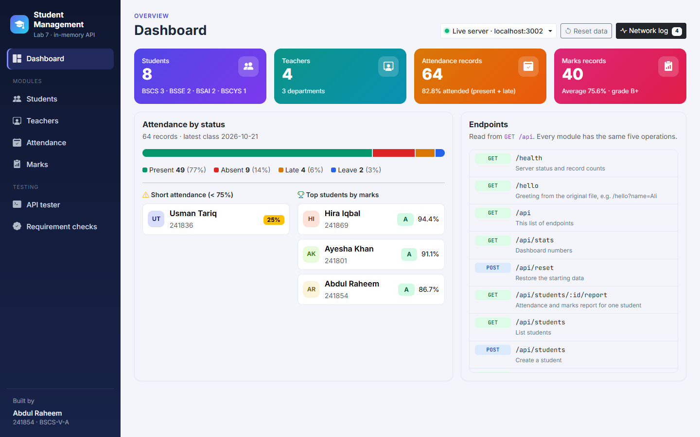

## Running it

Node.js 20 or newer is needed. Nothing has to be installed: the server uses only `node:http`.

```bash
npm start          # the API and the test UI on http://localhost:3002
npm run client     # in a second terminal: CRUD on all four modules with fetch()
npm test           # 11 automated tests (node:test)
```

| Open | What it shows |
|---|---|
| http://localhost:3002/ | the test UI |
| http://localhost:3002/api | every endpoint as JSON |
| http://localhost:3002/hello?name=Ali | the route from the original file |

## What was changed in the uploaded code

The uploaded file was a `node:http` server with two routes (`/health`, `/hello`) plus a `fetch()` client. Both are still here, extended:

| Uploaded code | Now |
|---|---|
| `http.createServer` with `new URL(req.url, 'http://localhost')` | unchanged, in [`server.js`](server.js) |
| `reply(code, body)` that does `res.end(JSON.stringify(body))` | unchanged. It now also adds CORS headers and logs every request. The comment *"why are we stringifying the JSON?"* and its answer are kept. |
| `if (req.method === 'GET' && url.pathname === '/health')` checks | a route table in [`lib/router.js`](lib/router.js) that matches the method and a path pattern such as `/api/students/:id` |
| `GET /health`, `GET /hello?name=` | still there. `/health` now also returns the record counts. |
| `reply(404, { error: 'Route not found' })` | still the answer for an unknown path. A wrong method on a known path gets **405** with an `Allow` header. |
| No request bodies | JSON bodies are read (up to 1 MB), parsed and validated |
| Step 23 client: `fetch` → `response.ok` → `response.json()` | [`client.js`](client.js) uses the same pattern for a 17-step CRUD walkthrough |
| — | 4 modules × 5 operations, a student report, dashboard stats and `POST /api/reset` |

The data is **in memory**: four `Map`-based collections in [`lib/db.js`](lib/db.js), filled from [`lib/seed.js`](lib/seed.js) when the server starts. Every change is lost when the server stops. (Part 2 of the lab is the persistent version.)

## Endpoints

Every module gets the same five operations:

| Method | Path | Does | Success |
|---|---|---|---|
| `GET` | `/api/<module>` | list, with filters, `?q=` search, `?sort=` (`-field` for descending), `?limit=` and `?offset=` | 200 `{ count, total, data }` |
| `GET` | `/api/<module>/:id` | read one | 200 `{ data }` |
| `POST` | `/api/<module>` | create | **201** `{ message, data }` + `Location` header |
| `PUT` | `/api/<module>/:id` | replace the whole record (all required fields) | 200 |
| `PATCH` | `/api/<module>/:id` | change only the fields that are sent | 200 |
| `DELETE` | `/api/<module>/:id` | delete. `?cascade=true` also deletes related records. | 200 `{ message, data, related }` |

The `<module>` is one of `students`, `teachers`, `attendance` or `marks`. There are also these endpoints:

| Method | Path | Does |
|---|---|---|
| `GET` | `/health`, `/hello?name=` | the routes from the original file |
| `GET` | `/api` | list of every endpoint |
| `GET` | `/api/students/:id/report` | attendance % per course, marks, grade and warnings (below 75% attendance, failing) |
| `GET` | `/api/stats` | dashboard numbers |
| `POST` | `/api/reset` | restore the starting data |

### The modules and their rules

| Module | Fields | Rules checked by the API |
|---|---|---|
| **Student** | `rollNo`, `name`, `email`, `program`, `semester`, `section` | roll number is exactly 6 digits and **unique** (409). Email is valid and **unique**. Program is BSCS, BSSE, BSAI, BSCYS or BSDS. Semester is 1–8. |
| **Teacher** | `name`, `email`, `designation`, `department`, `course`, `phone` | email is unique. Designation is one of four titles. Phone, if given, is `03XXXXXXXXX`. |
| **Attendance** | `studentId`, `teacherId`, `date`, `status`, `remarks` | the student and teacher must exist (422). The date is real and **not in the future**. Status is `present`, `absent`, `late` or `leave`. Only **one record per student, course and day** (409). |
| **Marks** | `studentId`, `teacherId`, `assessment`, `title`, `obtained`, `total` | **obtained ≤ total** (422, also checked on `PATCH`). Assessment is `quiz`, `assignment`, `lab`, `mid` or `final`. `percentage` and `grade` are worked out by the API. |

**Related records.** A teacher's `course` links attendance and marks to a course. Deleting a student or teacher who still has attendance or marks gets **409**, with the counts in `related`. Repeating the request with `?cascade=true` deletes them as well.

### Status codes

| Code | When |
|---|---|
| 200 / 201 | success. 201 is for creates, with a `Location` header. |
| 400 | the body is not valid JSON, the id is not a number, or there is an unknown query parameter or sort field |
| 404 | the route is unknown (`{ "error": "Route not found" }`) or the record doesn't exist |
| 405 | wrong method for the path. The `Allow` header lists the right ones. |
| 409 | duplicate roll number or email, the same attendance twice, or deleting a record that others depend on |
| 413 | the body is larger than 1 MB |
| 415 | the body was not sent as `Content-Type: application/json` |
| 422 | validation failed: `details` lists `{ field, message }` for each problem |

Example:

```http
POST /api/marks
Content-Type: application/json

{ "studentId": 1, "teacherId": 1, "assessment": "quiz", "title": "Quiz 2", "obtained": 12, "total": 10 }
```

```json
HTTP/1.1 422 Unprocessable Entity

{ "error": "The marks record has 1 invalid field.",
  "details": [ { "field": "obtained", "message": "Obtained marks (12) cannot be more than total marks (10)." } ] }
```

## The test UI

Every screen reads and writes **only through the API**, and the **Network log** button shows every request and response. The UI does no validation of its own, so the error messages you see under the form fields come from the API's 422 and 409 responses.

| Students: list with filters and search | Marks: percentage and grade worked out by the API |
|---|---|
| 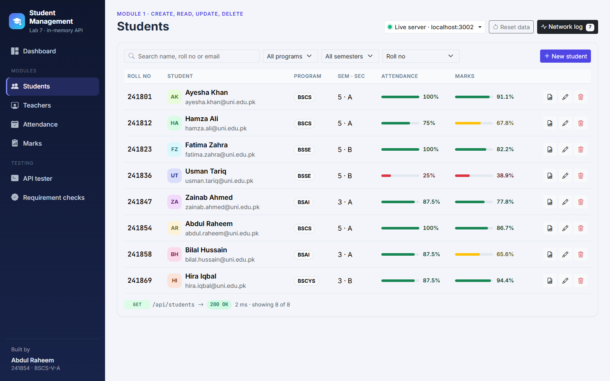 | 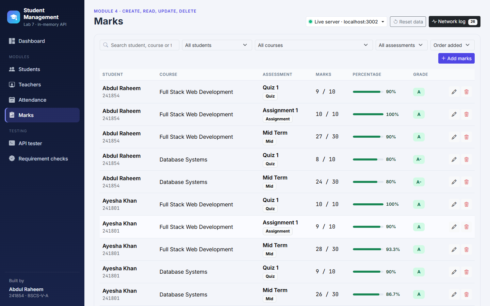 |

| Students: create with invalid fields (422) | Student report |
|---|---|
| 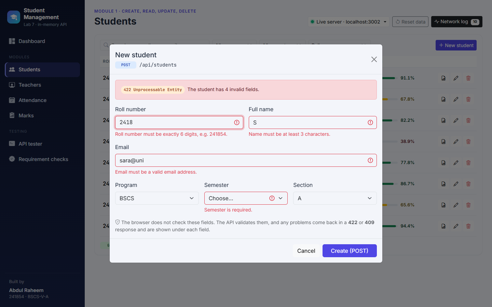 | 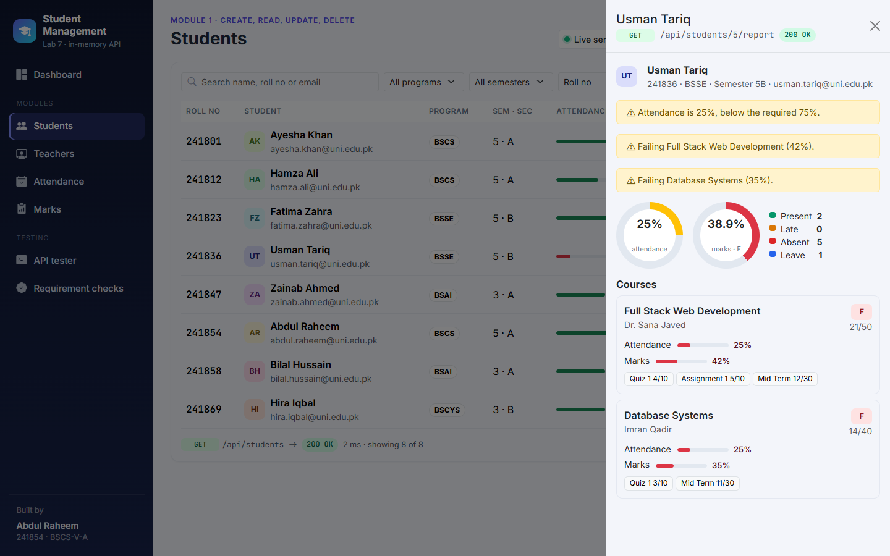 |

| Delete refused (409), then the cascade option | Teachers |
|---|---|
| 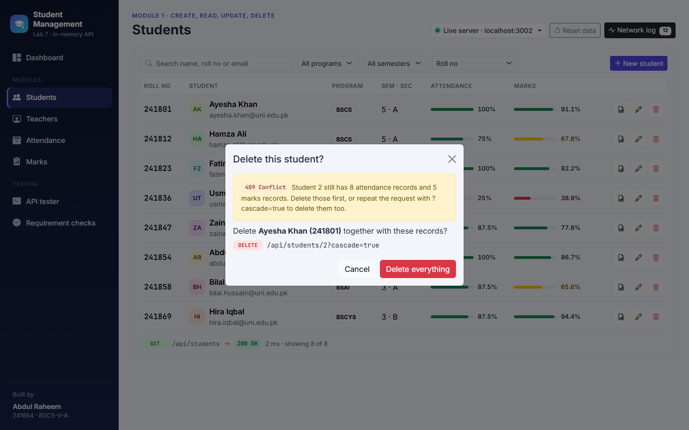 | 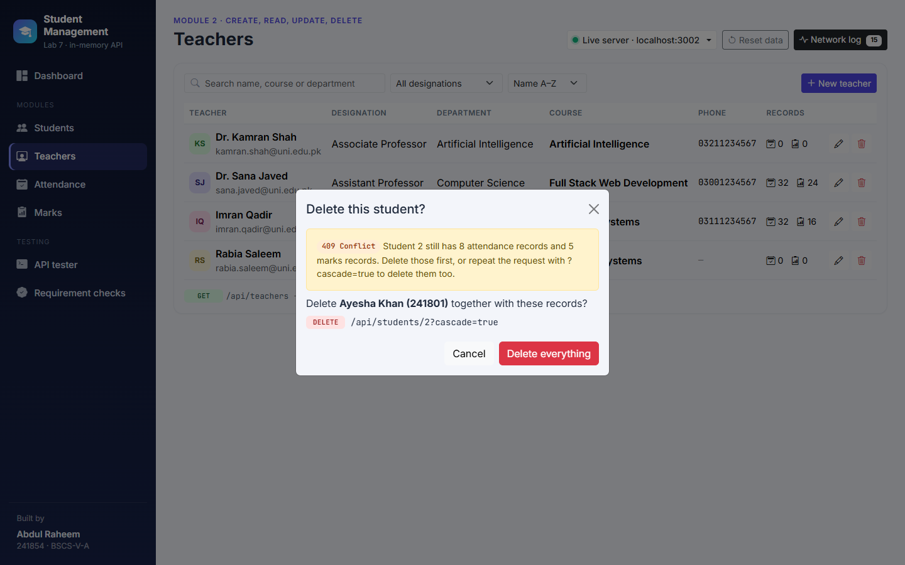 |

| Attendance: class register (POST, PATCH, DELETE) | Marks: edit with PATCH (422 shown) |
|---|---|
| 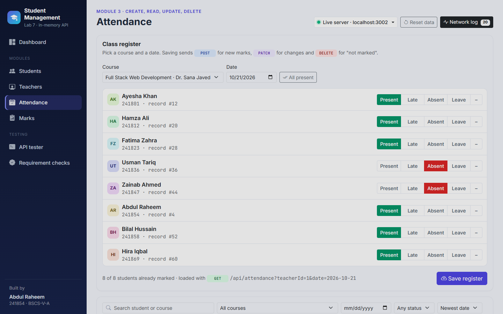 | 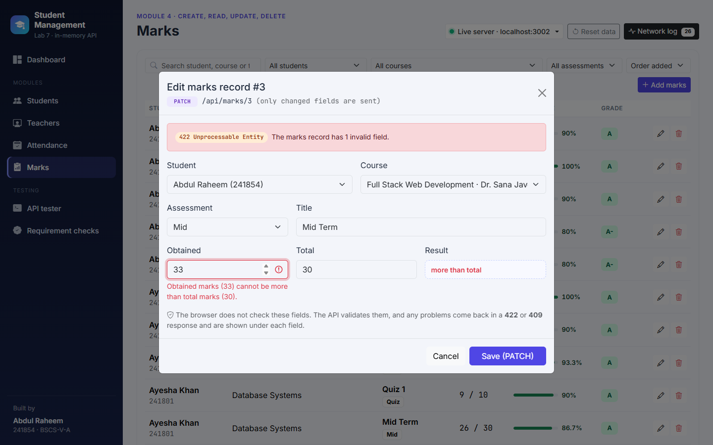 |

| API tester | Network log |
|---|---|
| 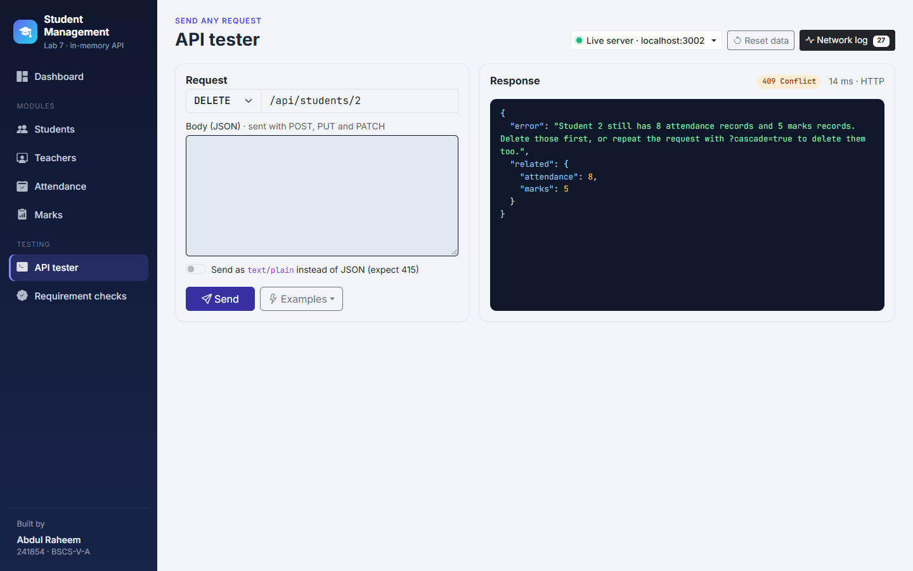 | 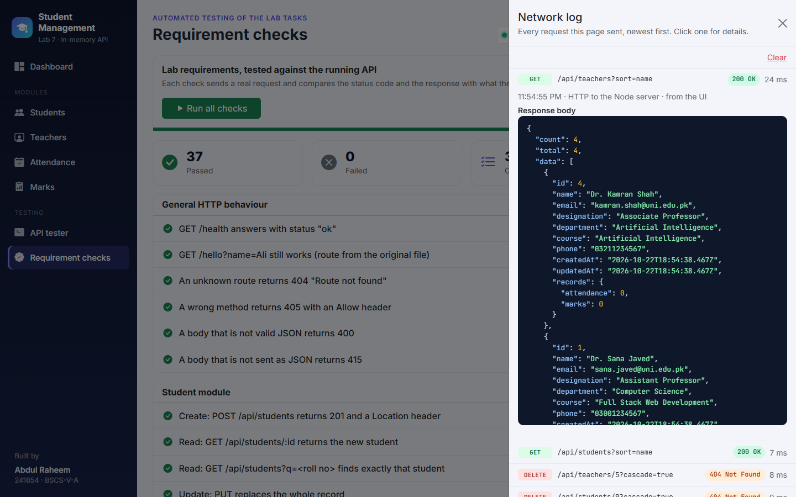 |

### Requirement checks

The **Requirement checks** page runs **37 checks** against whichever API is connected:
- the general HTTP rules (404, 405, 400, 415 and the original routes);
- create, read, PUT, PATCH, delete and validation for each module;
- duplicates, future dates and missing references;
- the report, and delete with and without cascade.

Each check compares the status code and the response body with what the lab requires. The checks clean up after themselves.

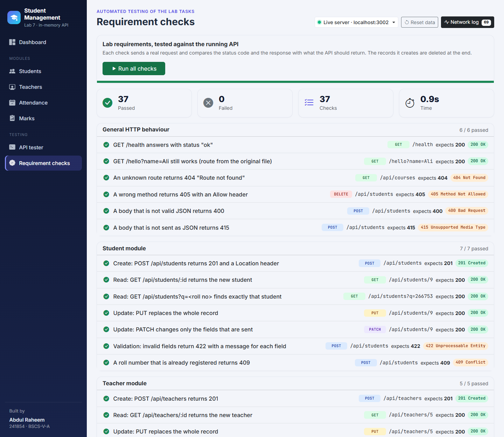

[Full page of results](screenshots/checks-full.png)

| Phone | Phone |
|---|---|
| 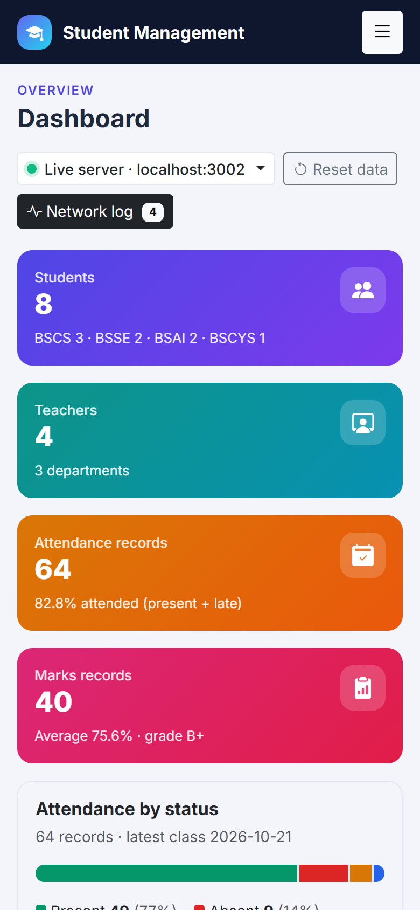 | 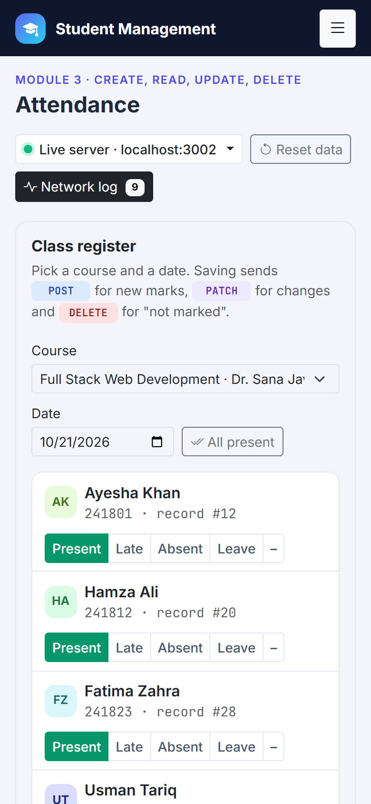 |

## From the terminal

`npm run client` (the modified Step 23 file):

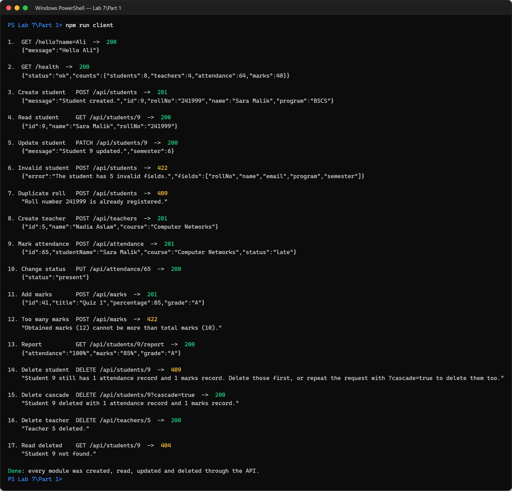

| `npm start`: the server logs each request | `npm test` |
|---|---|
| 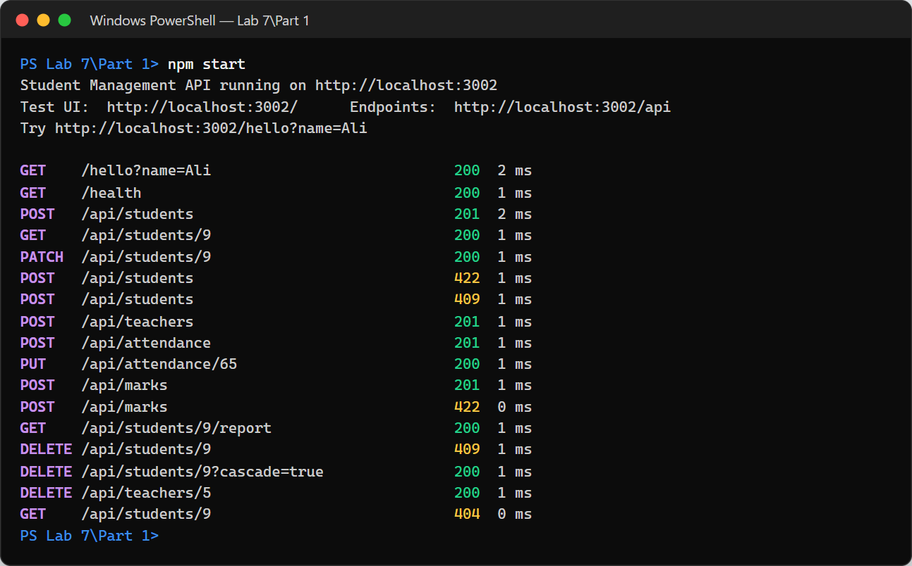 | 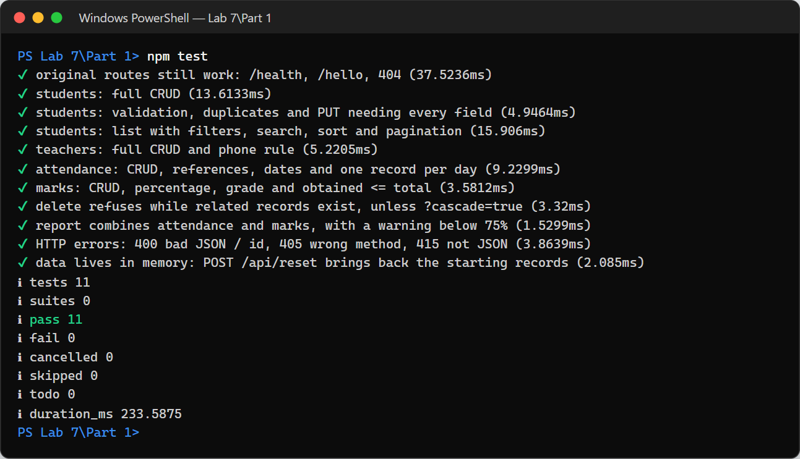 |

## Why is the JSON stringified? (question in the uploaded file)

`res.end()` does not accept ordinary JavaScript objects as the response body. It needs a string, a `Buffer` or a `Uint8Array` (or nothing). `JSON.stringify()` turns the object into JSON text, `Content-Type: application/json` tells the client what it is, and the client turns it back into an object with `response.json()`.

## Structure

```
Part 1/
├── server.js           the uploaded node:http server, modified (port 3002)
├── client.js           the uploaded fetch() client, modified: CRUD on every module
├── lib/                the API, used by the server and by the UI on GitHub Pages
│   ├── router.js       routes, body parsing, CRUD handlers, report, stats, errors
│   ├── modules.js      the four modules: fields, unique rules, relations, grades
│   ├── validate.js     schema validation (422 details)
│   ├── db.js           in-memory collections (Map + next id)
│   └── seed.js         8 students, 4 teachers, 64 attendance and 40 marks records
├── public/             test UI: index.html · app.js · transport.js · checks.js · style.css
├── tests/api.test.js   11 tests
└── screenshots/
```
