# Lab 7 · Part 2 — Kashi Ghar store API (persistent)

**Student:** Abdul Raheem · 241854 · BSCS-V-A (Shift-I) · Air University, Islamabad

> **Task:** Write end-points of the e-commerce store (already assigned to you in Lab 3) by using **persistent APIs**.

The Lab 3 store, *Kashi Ghar*, kept everything in the browser's `localStorage`: the product catalogue, the accounts, the cart, the orders and the reviews. This part gives it a back end:

- A **REST API** ([`lib/router.js`](lib/router.js)) owns all of that data.
- The API saves every change to **`data/db.json`**, so the data is still there after the server restarts.
- A **copy of the Lab 3 store** ([`store/`](store/)) now loads and changes everything through the API.

The original [`Lab 3`](../../Lab%203/Task-2-Ecommerce-Store/) folder was not touched.

**Live store:** [raheemxghumman.github.io/FULL-STACK-LAB/Lab 7/Part 2/store](https://raheemxghumman.github.io/FULL-STACK-LAB/Lab%207/Part%202/store/)

GitHub Pages cannot run Node.js, so on Pages the store loads the same API code into the page, and the API saves its database in that browser's `localStorage`. Run `npm start` to use the real server and the `data/db.json` file. The footer of every page says which one is in use.

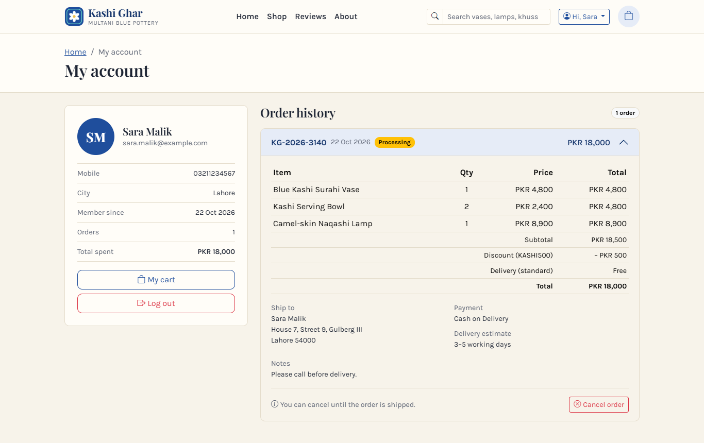

## Running it

Node.js 20 or newer. No packages are needed.

```bash
npm start              # API + store on http://localhost:3000  (store at /store/, endpoints at /api)
npm run demo           # in a second terminal: a whole purchase through the API with fetch()
npm run restart-check  # proves persistence: order, stop the server, start a new one, data is still there
npm test               # 9 automated tests (uses a temporary database file)
npm run reset-db       # delete data/db.json; the next start begins again from the seed data
```

| Account | Email | Password |
|---|---|---|
| customer | `demo@kashighar.pk` | `demo1234` |
| admin (can change products) | `admin@kashighar.pk` | `admin1234` |

## How the data persists

- **First request.** On the very first request, [`lib/seed.js`](lib/seed.js) creates `data/db.json`. It holds the Lab 3 catalogue (12 products), 9 reviews and the two accounts above.
- **Every request.** Each request reads the database. Each successful change is written back before the response is sent.
- **Safe writes.** [`lib/storage-file.js`](lib/storage-file.js) writes to a temporary file first and then renames it over `db.json`. A rename is atomic, so a crash can never leave a half-written database.
- **No lost updates.** Requests are handled one at a time, so two changes can never overwrite each other.
- **Passwords.** Passwords are stored only as salted **PBKDF2-SHA256** hashes ([`lib/security.js`](lib/security.js)). The API never returns a hash.
- **Not in git.** `data/` is listed in `.gitignore`, and the server never serves that folder.

`npm run restart-check` shows it working: it starts **two separate server processes** on the same file.

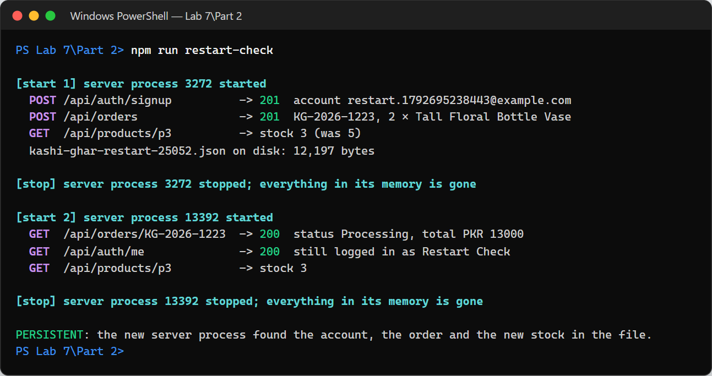

## Endpoints

To log in, call `POST /api/auth/login` or `POST /api/auth/signup`. Both return a `token`, which is sent with later requests as `Authorization: Bearer <token>`. The **Auth** column says who may call each endpoint:

- **–** anyone
- **optional** anyone, but a logged-in user gets extra (a "verified" review)
- **user** a logged-in user (401 otherwise)
- **admin** the admin account (401 if not logged in, 403 for a customer)

| Group | Method | Path | Auth | Does |
|---|---|---|---|---|
| General | `GET` | `/health` | – | status, storage in use, record counts |
| | `GET` | `/api` | – | list of every endpoint |
| Catalogue | `GET` | `/api/categories` | – | categories with product counts |
| | `GET` | `/api/delivery-options` | – | standard and express fees, free-delivery limit |
| | `GET` | `/api/products` | – | `?category=` `?q=` `?sort=featured\|price-asc\|price-desc\|rating\|name\|newest` `?minPrice=` `?maxPrice=` `?inStock=true` |
| | `GET` | `/api/products/:id` | – | one product with its rating |
| | `POST` | `/api/products` | admin | add a product (201) |
| | `PUT` / `PATCH` | `/api/products/:id` | admin | replace / change fields (e.g. stock) |
| | `DELETE` | `/api/products/:id` | admin | remove it, also from carts. Past orders keep their copy. |
| Reviews | `GET` | `/api/reviews` | – | newest first, `?productId=` `?limit=` |
| | `GET` | `/api/reviews/summary` | – | 1–5 star distribution for the whole shop |
| | `GET` | `/api/products/:id/reviews` | – | reviews of one product |
| | `POST` | `/api/reviews` | optional | post a review. It is marked "verified buyer" when logged in. |
| | `DELETE` | `/api/reviews/:id` | admin | delete a review |
| Accounts | `POST` | `/api/auth/signup` | – | create an account → `{ token, user }` (409 if the email is taken) |
| | `POST` | `/api/auth/login` | – | `{ email, password, remember }` → `{ token, user }` (401 if wrong) |
| | `GET` | `/api/auth/me` | user | the logged-in account |
| | `POST` | `/api/auth/logout` | user | ends that token |
| | `GET` | `/api/auth/email-available` | – | `?email=` (used by the signup form while you type) |
| Cart | `POST` | `/api/carts` | – | new cart (201). Its id is kept in the browser. |
| | `GET` | `/api/carts/:id` | – | lines, count and totals for each delivery method |
| | `POST` | `/api/carts/:id/items` | – | `{ productId, qty }`. It never goes above the stock (409 when already at stock). |
| | `PATCH` | `/api/carts/:id/items/:productId` | – | `{ qty }` from 1 to the stock (422 otherwise) |
| | `DELETE` | `/api/carts/:id/items/:productId` | – | remove one line |
| | `DELETE` | `/api/carts/:id/items` | – | empty the cart and remove the coupon |
| | `PUT` / `DELETE` | `/api/carts/:id/coupon` | – | apply `MULTAN10` / `KASHI500` (422 if invalid) / remove it |
| Orders | `POST` | `/api/orders` | user | places an order from a cart, as described below. 409 if the cart is empty or short of stock. |
| | `GET` | `/api/orders` | user | my orders, newest first (the admin sees all) |
| | `GET` | `/api/orders/:id` | user | one order (404 for other people's orders) |
| | `PATCH` | `/api/orders/:id` | user | `{ status }`: a customer can **cancel** while Processing (the stock goes back). The admin moves orders to Shipped and Delivered. |

`POST /api/orders` does all of this in one request:
- validates the contact, shipping and payment details;
- refuses full card numbers (only `last4` is accepted);
- **takes the items out of stock**;
- empties the cart.

Errors use the same codes as Part 1: 400 (bad JSON or query), 401, 403, 404, 405, 409, 415 and **422** with `details: [{ field, message }]`. Nested fields are named like `shipping.postal`.

## What changed in the store

| File | Lab 3 | Lab 7 |
|---|---|---|
| `js/api.js` | – | **new**: sends requests to the Node server, or runs `lib/router.js` in the page when there is no server |
| `js/app.js` | read and wrote `localStorage` | every function calls the API. Only the **cart id** and the **login token** are kept in the browser. |
| `js/products.js` | catalogue, reviews, rating totals, SVG pictures | SVG pictures only. The data moved to the API (`lib/seed.js`). |
| `js/shop.js` | filtered and sorted in the browser | `GET /api/products?category=&q=&sort=`, and reviews with `POST /api/reviews` |
| `js/cart.js` | edited `localStorage` | `PATCH` / `DELETE` cart lines and `PUT` coupons. A wrong quantity gets the API's 422. |
| `js/checkout.js` | saved the order locally | `POST /api/orders`: the server re-checks everything and updates the stock |
| `js/account.js` | listed local orders | `GET /api/orders`, plus a new **Cancel order** button (`PATCH /api/orders/:id`) |
| `js/auth.js` | hashed passwords in the browser | `POST /api/auth/signup` and `/login`. "Email already used" comes from the API. |

The pages, the CSS and the layout are the same as Lab 3.

## Screenshots

All of these were taken with the store running on the Node server (`npm start`).

| Home page (catalogue from `GET /api/products`) | Phone: shop |
|---|---|
| 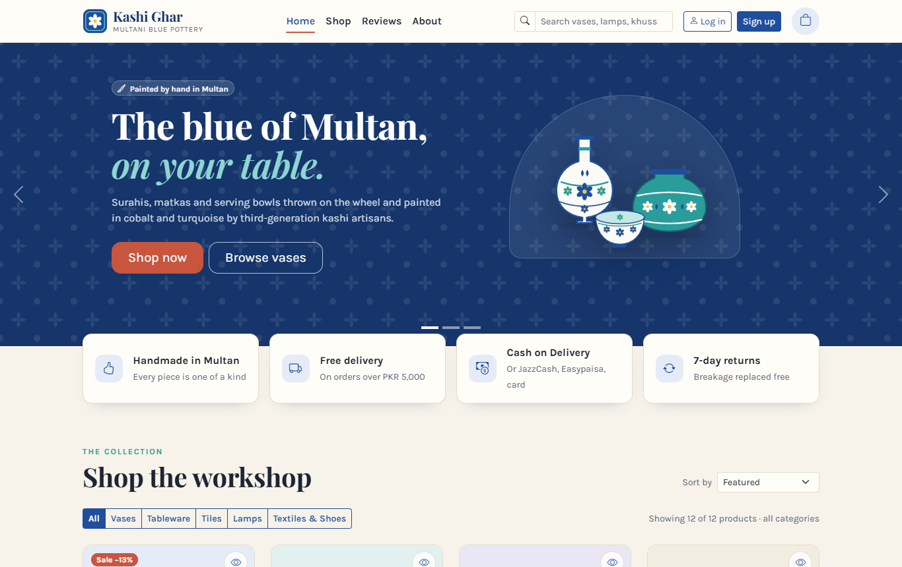 | 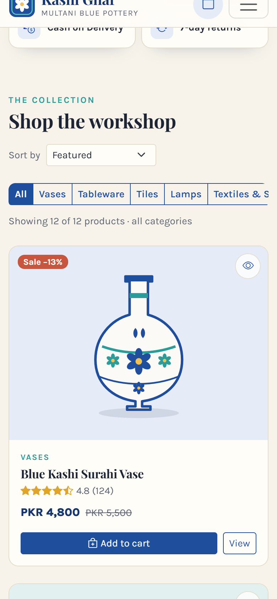 |

| Shop: items added through the API | Filter done by the API (`?category=lamps`) |
|---|---|
| 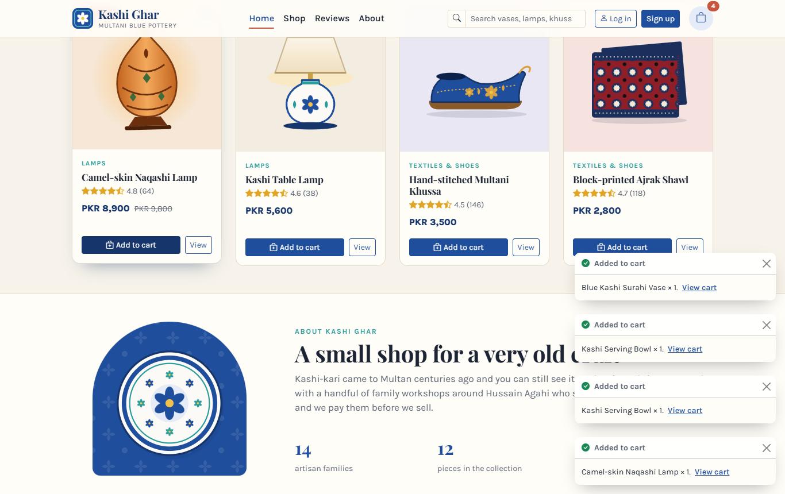 | 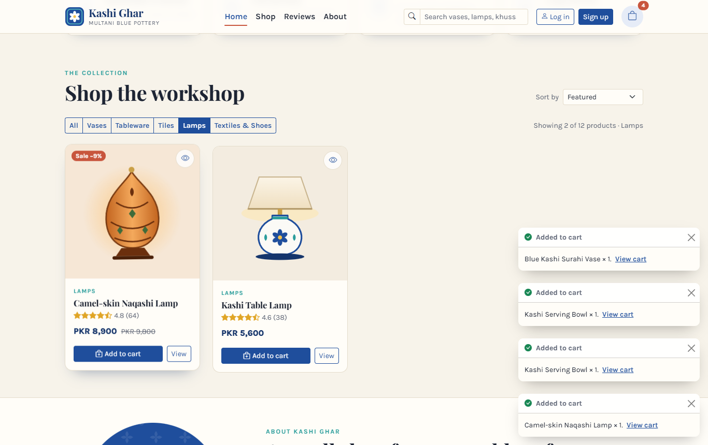 |

| Cart with a coupon (totals from the API) | Signup: email already taken (asked from the API) |
|---|---|
| 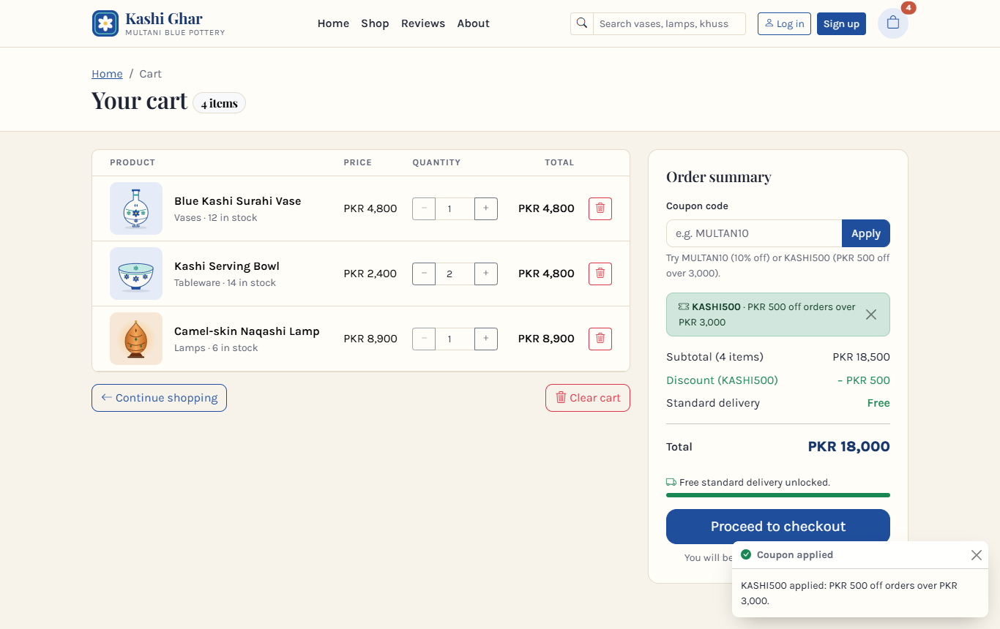 | 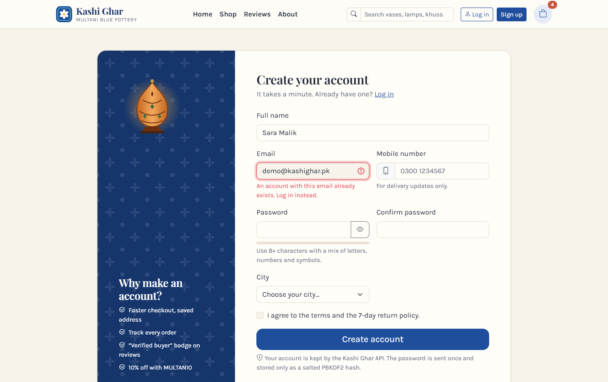 |

| Checkout | Order placed |
|---|---|
| 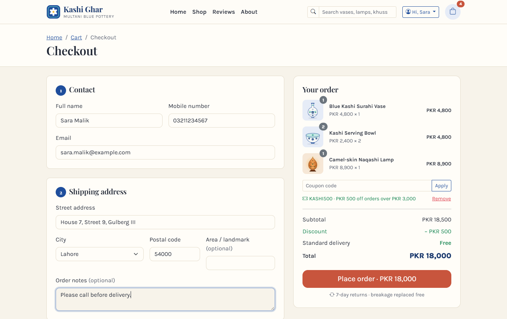 | 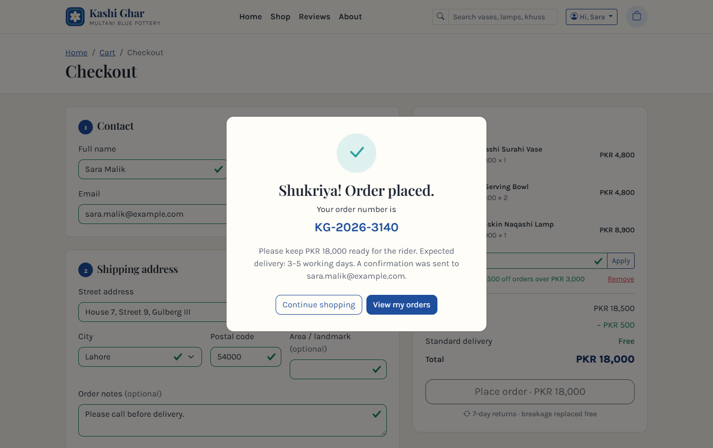 |

| Stock went down after the order (6 → 5) | Phone: mini-cart |
|---|---|
|  | 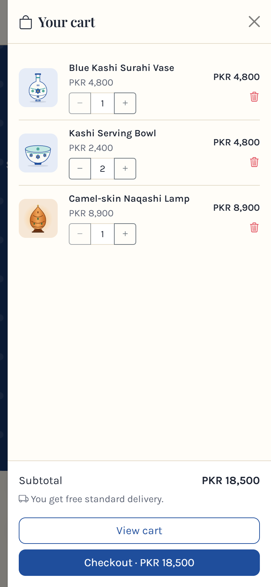 |

The footer shows where the data comes from:

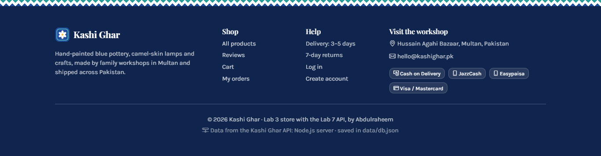

### From the terminal

`npm run demo`: browse, cart, coupon, a 401 without login, then log in, order, stock check and cancel.

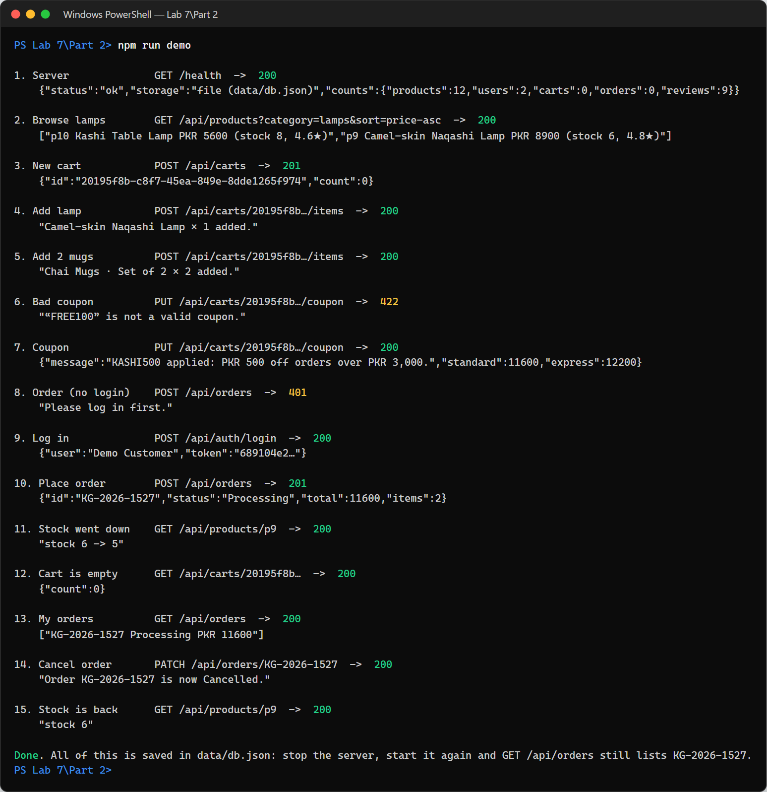

| `npm start` (each request is logged) | `npm test` |
|---|---|
| 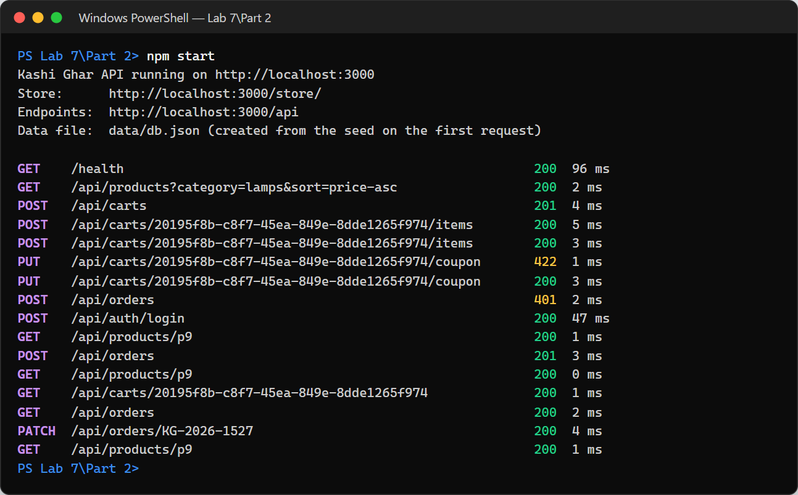 | 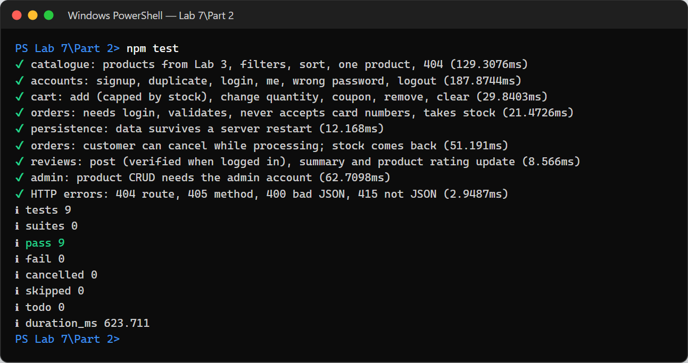 |

## Structure

```
Part 2/
├── server.js              node:http server: the API, the store at /store/, data in data/db.json (port 3000)
├── client.js              npm run demo: a whole purchase with fetch()
├── lib/                   the API (also loaded by the store on GitHub Pages)
│   ├── router.js          every endpoint, auth, validation, totals, orders, persistence per request
│   ├── seed.js            Lab 3 catalogue and reviews, delivery, coupons, starting accounts
│   ├── validate.js        schema validation (same as Part 1, plus nested fields)
│   ├── security.js        PBKDF2 password hashing, random ids and tokens
│   ├── storage-file.js    saves to data/db.json (atomic write)
│   └── storage-browser.js saves to localStorage (GitHub Pages only)
├── store/                 copy of the Lab 3 store, now using the API
├── scripts/restart-check.js
├── tests/api.test.js      9 tests, including a server restart
├── data/                  db.json is created here (not in git)
└── screenshots/
```
