# Full Stack Web Development — Lab 8: NestJS backend for the e-commerce store

**Student:** Abdul Raheem · 241854 · BSCS-V-A (Shift-I) · Air University, Islamabad

> **Task:** Take the Lab 3 e-commerce store and make its backend in **NestJS**.

**Preview page:** [raheemxghumman.github.io/FULL-STACK-LAB/Lab 8](https://raheemxghumman.github.io/FULL-STACK-LAB/Lab%208/)

| [Store demo](https://raheemxghumman.github.io/FULL-STACK-LAB/Lab%208/frontend/) | [API docs (Swagger)](https://raheemxghumman.github.io/FULL-STACK-LAB/Lab%208/docs/) |
|---|---|

The Lab 3 store (*Kashi Ghar*, Multani blue pottery) kept everything in the browser's `localStorage`. In this lab:

- the store was **copied** into [`frontend/`](frontend/); the original [`Lab 3`](../Lab%203/Task-2-Ecommerce-Store/) folder is unchanged;
- a **NestJS backend** written in TypeScript ([`backend/`](backend/)) now owns all the data: products, categories, accounts, carts, coupons, orders and reviews;
- every page of the store loads and changes that data through the backend's REST API;
- the data is saved to `backend/data/db.json`, so it is still there after the server restarts.

> GitHub Pages can only serve files; it cannot run a NestJS server. On the preview site the store demo therefore uses a small stand-in API that runs in the browser with the same endpoints ([`preview-api/`](preview-api/)), and the Swagger page shows the backend's real API description. To use the real NestJS backend, run it as shown below. The store's footer always says which one is in use.

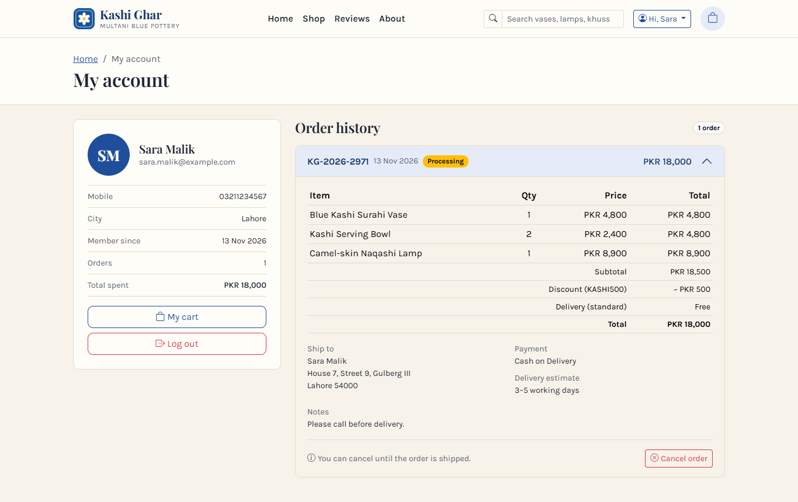

## Running the backend

You need Node.js 20 or newer.

```bash
cd "Lab 8/backend"
npm install
npm start        # compiles the TypeScript, then starts NestJS on http://localhost:3000
npm test         # 9 tests against the real app, including a restart on the same data file
```

| Open | What it is |
|---|---|
| http://localhost:3000/store/ | the store, using the backend |
| http://localhost:3000/docs | Swagger UI: every endpoint, with **Try it out** |
| http://localhost:3000/api | list of endpoints as JSON |
| http://localhost:3000/health | status and record counts |

| Account | Email | Password |
|---|---|---|
| customer | `demo@kashighar.pk` | `demo1234` |
| admin (can change products) | `admin@kashighar.pk` | `admin1234` |

To start again with fresh data, delete `backend/data/db.json`. It is rebuilt from the Lab 3 catalogue on the next start.

## How the NestJS backend is built

```
Store page (frontend/js/api.js)
   │  fetch("/api/...")  +  Authorization: Bearer <token>
   ▼
Controller  ──  ValidationPipe checks the body/query against a DTO (class-validator)  ──  AuthGuard checks @Auth()
   ▼
Service (the business rules: stock, coupons, totals, order status)
   ▼
DatabaseService  →  data/db.json  (atomic write after every change)
```

| Module | Controllers | What it does |
|---|---|---|
| `DatabaseModule` (global) | – | `DatabaseService` loads `data/db.json` on start. On the very first start it creates the file from the Lab 3 catalogue (12 products, 9 reviews, 2 accounts). Every change is written to a temporary file that is then renamed over `db.json`. |
| `AuthModule` | `AuthController` | Signup and login. Passwords are stored as salted PBKDF2-SHA256 hashes, and login tokens expire after 1 or 30 days. A global `AuthGuard` (`APP_GUARD`) reads the token and enforces `@Auth("user")`, `@Auth("admin")` or `@Auth("optional")`. `@CurrentUser()` passes the logged-in user to a handler. |
| `CatalogModule` | `ProductsController`, `CatalogController` | Products with category, search, price and stock filters, and sorting. Also categories and delivery options. The admin can create, replace, update and delete products. |
| `ReviewsModule` | `ReviewsController`, `ProductReviewsController` | Reviews are newest first and marked "verified buyer" when logged in. Each product's rating and the shop-wide star summary include new reviews. |
| `CartsModule` | `CartsController` | Carts are kept on the server, and quantities never go above the stock. Coupons are `MULTAN10` (10% off) and `KASHI500` (PKR 500 off over PKR 3,000). Totals are given for both standard and express delivery. |
| `OrdersModule` | `OrdersController` | Checkout uses nested DTOs for contact, shipping and payment, and full card numbers are refused. Placing an order checks the stock, takes the items out of stock and empties the cart. The order history is per user, and customers can cancel while an order is Processing (the stock goes back). The admin can mark orders Shipped and Delivered. |

Other NestJS pieces:

- **One global `ValidationPipe`** ([`common/validation.ts`](backend/src/common/validation.ts)) has `whitelist`, `forbidNonWhitelisted` and `transform` switched on. Invalid input gets **422** with `details: [{ field, message }]`, including nested fields such as `shipping.postal`.
- **One exception filter** ([`common/api-exception.filter.ts`](backend/src/common/api-exception.filter.ts)) gives every error the same shape: `{ statusCode, error, details? }`. The store's pages show those messages next to the right field.
- **Swagger** (`@nestjs/swagger`) builds the documentation from the controllers and DTOs. `npm run openapi` writes it to [`docs/openapi.json`](docs/openapi.json) for the preview page.
- **The store's pages** are served by Nest itself (`useStaticAssets`) at `/store/`, so the store and the API share one origin.

### Endpoints (32)

| Group | Method | Path | Login | Does |
|---|---|---|---|---|
| General | `GET` | `/health`, `/api` | – | status and counts / list of endpoints |
| Products | `GET` | `/api/products` | – | `?category=` `?q=` `?sort=featured\|price-asc\|price-desc\|rating\|name\|newest` `?minPrice=` `?maxPrice=` `?inStock=true` |
| | `GET` | `/api/products/:id` | – | one product with its rating |
| | `POST` · `PUT` · `PATCH` · `DELETE` | `/api/products[/:id]` | admin | add, replace, change, remove |
| Catalogue | `GET` | `/api/categories`, `/api/delivery-options` | – | categories with counts, delivery fees |
| Reviews | `GET` | `/api/reviews`, `/api/reviews/summary`, `/api/products/:id/reviews` | – | lists and the star distribution |
| | `POST` | `/api/reviews` | optional | post a review (verified when logged in) |
| | `DELETE` | `/api/reviews/:id` | admin | delete a review |
| Accounts | `POST` | `/api/auth/signup`, `/api/auth/login` | – | return `{ token, user }` |
| | `GET` · `POST` | `/api/auth/me`, `/api/auth/logout` | user | the account / end the login |
| | `GET` | `/api/auth/email-available?email=` | – | used by the signup form while you type |
| Cart | `POST` · `GET` | `/api/carts`, `/api/carts/:id` | – | create, read with totals |
| | `POST` · `PATCH` · `DELETE` | `/api/carts/:id/items[/:productId]` | – | add (stock-capped), set quantity, remove, empty |
| | `PUT` · `DELETE` | `/api/carts/:id/coupon` | – | apply / remove a coupon |
| Orders | `POST` · `GET` | `/api/orders`, `/api/orders/:id` | user | place an order, my orders |
| | `PATCH` | `/api/orders/:id` | user | cancel (customer) or ship/deliver (admin) |

**Status codes:**

| Code | When |
|---|---|
| 200 / 201 | success |
| 400 | the body is not valid JSON |
| 401 | not logged in, or the token is wrong or expired |
| 403 | logged in, but the route needs the admin |
| 404 | the record doesn't exist (or is someone else's order) |
| 409 | already at the stock limit, empty cart, short of stock, email already used, or an order status that can't change |
| 422 | validation failed: see `details` |

## What changed in the store copy

Only the JavaScript changed. The HTML pages and CSS are the Lab 3 ones.

| File | Lab 3 | Lab 8 |
|---|---|---|
| `js/api.js` | – | **new**: sends every request to the NestJS backend. On GitHub Pages it uses the stand-in in `preview-api/` instead. |
| `js/app.js` | read and wrote `localStorage` | calls the backend for everything. The browser only keeps the cart id and the login token. |
| `js/products.js` | catalogue, reviews and SVG pictures | SVG pictures only. The catalogue lives in the backend (`backend/src/database/seed.ts`). |
| `js/shop.js` | filtered and sorted in the browser | `GET /api/products?category=&q=&sort=`, and `POST /api/reviews` |
| `js/cart.js` · `checkout.js` | local cart and orders | cart endpoints, coupons, and `POST /api/orders`. The backend re-checks everything and updates the stock. |
| `js/account.js` | local order list | `GET /api/orders`, plus a **Cancel order** button (`PATCH /api/orders/:id`) |
| `js/auth.js` | hashed passwords in the browser | `POST /api/auth/signup` and `/login`. The "email already used" warning comes from the backend. |

## Screenshots

All of these were taken with the store running on the NestJS backend (`npm start`).

| Home (catalogue from `GET /api/products`) | Items added, cart badge from the backend |
|---|---|
| 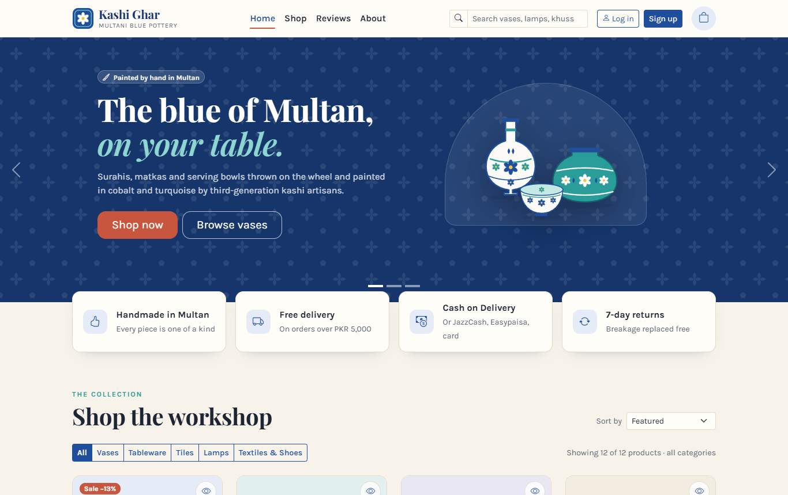 | 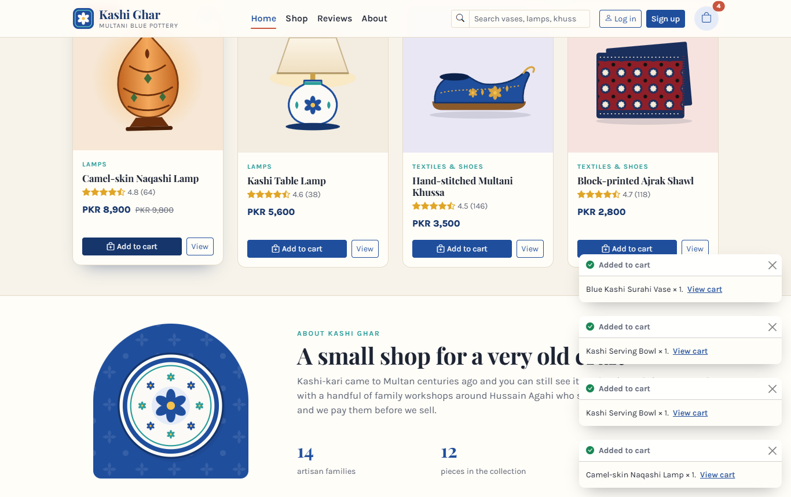 |

| Filter done by the backend (`?category=lamps`) | Cart with coupon KASHI500 (totals from the backend) |
|---|---|
| 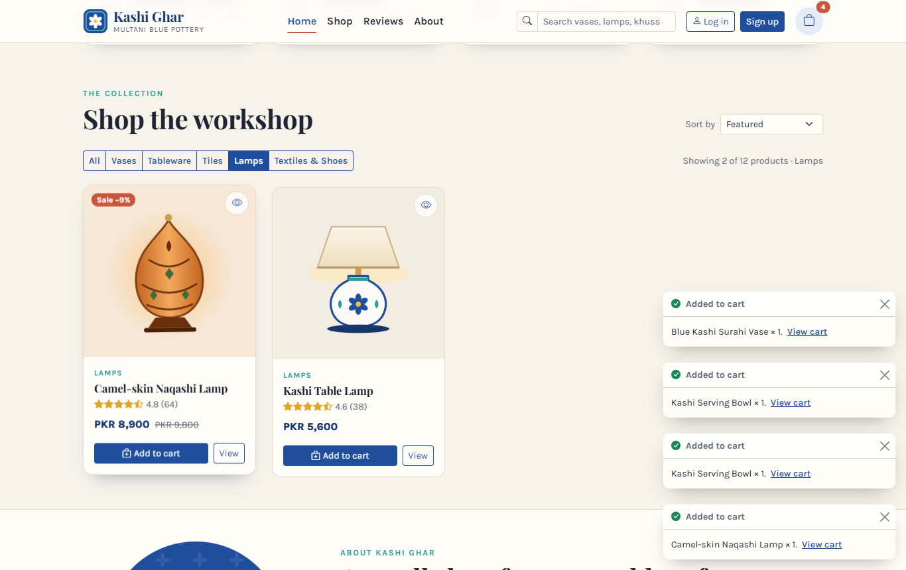 | 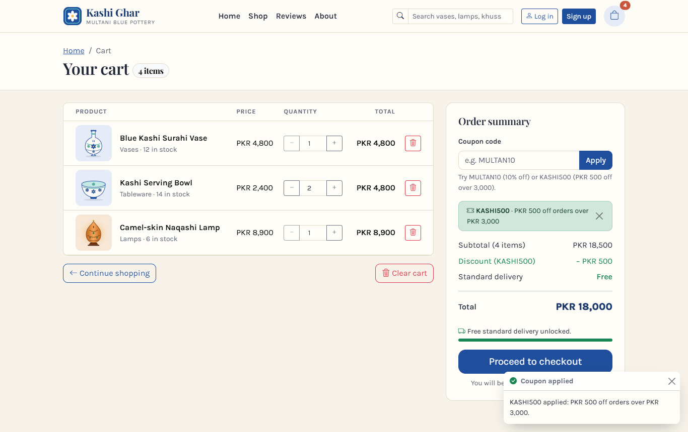 |

| Signup: email already taken (asked from the backend) | Checkout |
|---|---|
| 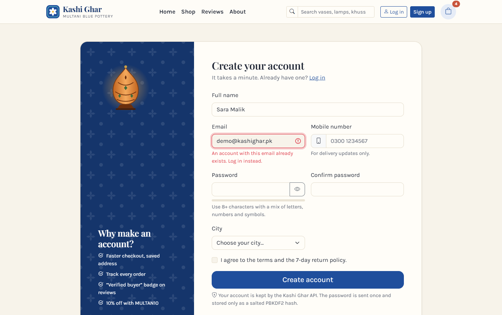 | 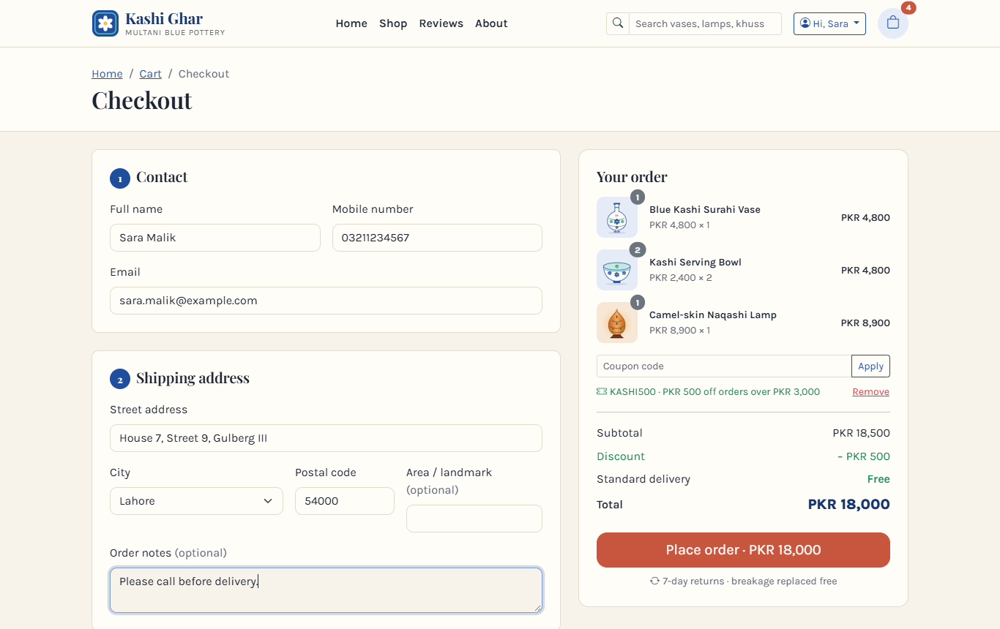 |

| Order placed (`POST /api/orders`, 201) | Stock went down after the order (6 → 5) |
|---|---|
| 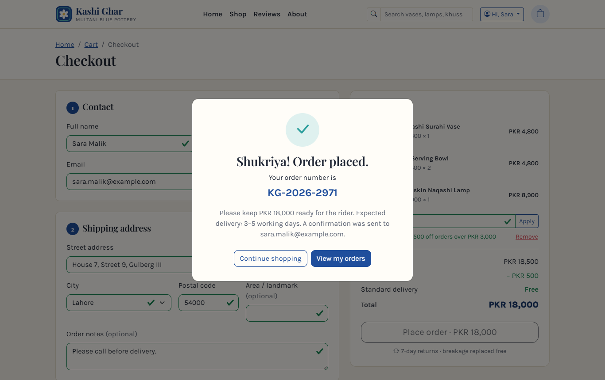 | 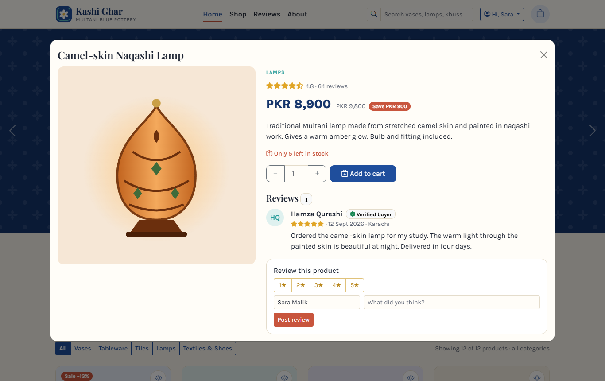 |

| Swagger documentation (`/docs`) | Phone: mini-cart |
|---|---|
| 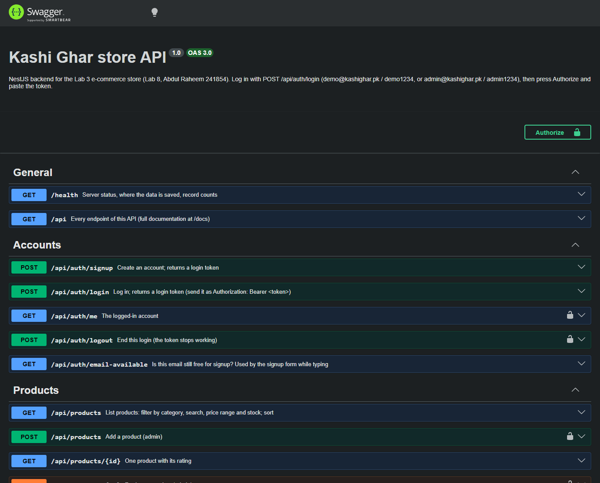 | 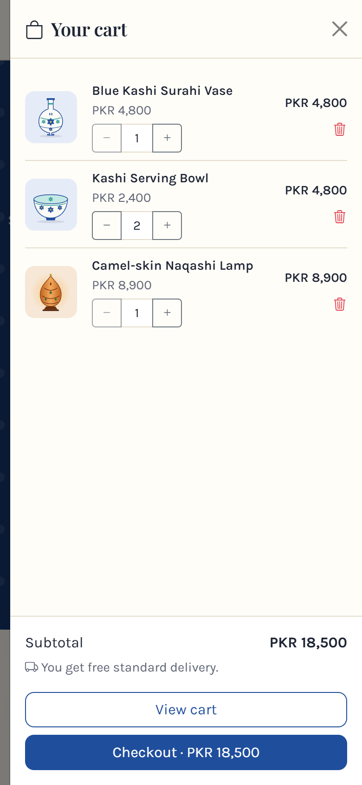 |

The footer shows where the data comes from:

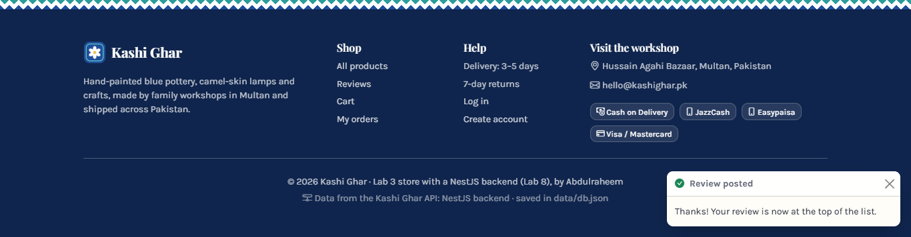

### Terminal

`npm start`: Nest loads the modules, maps the routes, creates `data/db.json`, then logs every request.

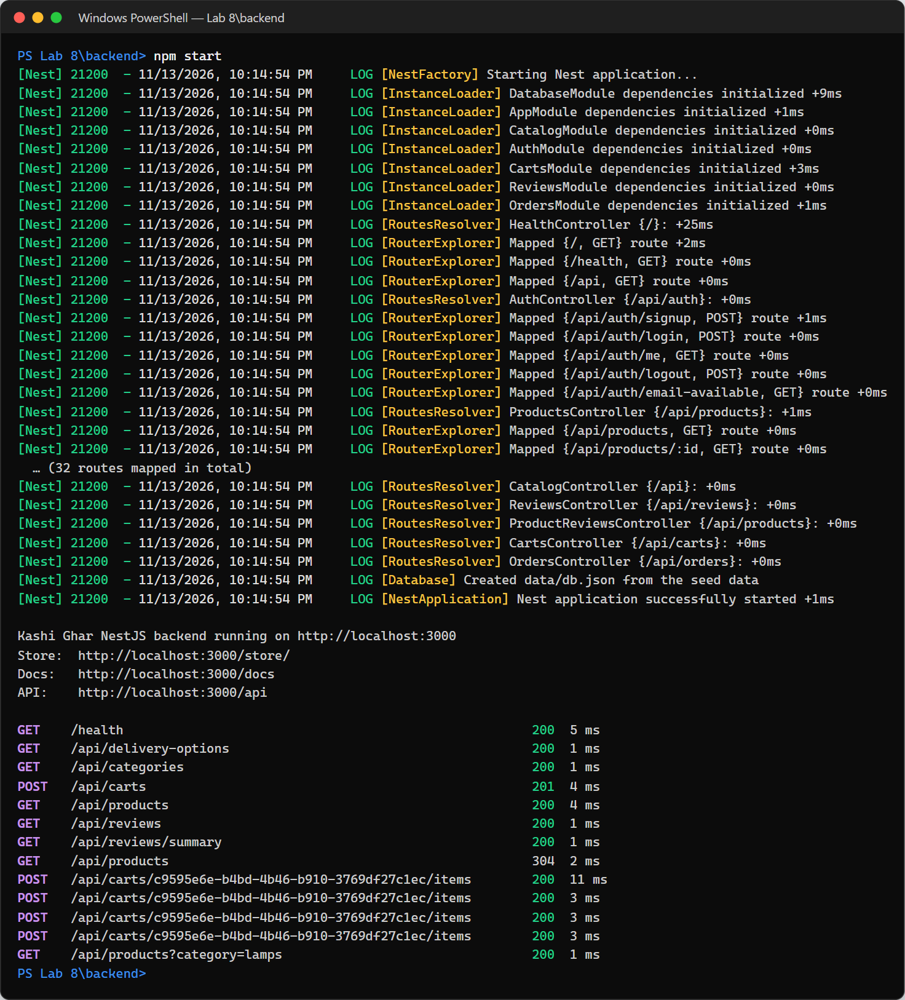

Persistence: the server was stopped and started again. It loaded the data back from `data/db.json`, and the order placed before the restart is still there.

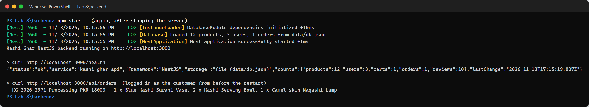

`npm test`: 9 tests against the real NestJS app.

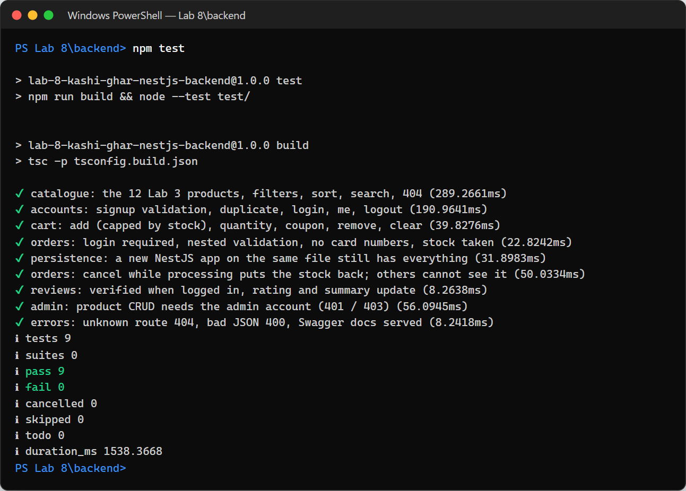

## Structure

```
Lab 8/
├── index.html              preview page (GitHub Pages)
├── backend/                the NestJS backend (TypeScript)
│   ├── src/
│   │   ├── main.ts         bootstrap: ValidationPipe, exception filter, CORS, Swagger, store pages
│   │   ├── app.module.ts   root module
│   │   ├── database/       DatabaseModule, DatabaseService (data/db.json), types, seed (Lab 3 catalogue)
│   │   ├── auth/           AuthModule: controller, service, DTOs, AuthGuard, @Auth / @CurrentUser
│   │   ├── catalog/        CatalogModule: products and catalogue controllers, ProductsService, DTOs
│   │   ├── reviews/        ReviewsModule
│   │   ├── carts/          CartsModule
│   │   ├── orders/         OrdersModule
│   │   ├── health/         /health, /api, / → /store/
│   │   ├── common/         ValidationPipe setup, exception filter, password hashing
│   │   └── openapi.ts      npm run openapi → docs/openapi.json
│   ├── test/api.test.js    9 tests
│   ├── package.json · tsconfig.json
│   └── data/db.json        created on first start (not in git)
├── frontend/               copy of the Lab 3 store, now using the backend
├── preview-api/            browser stand-in for the GitHub Pages demo only (not the backend)
├── docs/                   Swagger UI preview page + openapi.json
└── screenshots/
```
